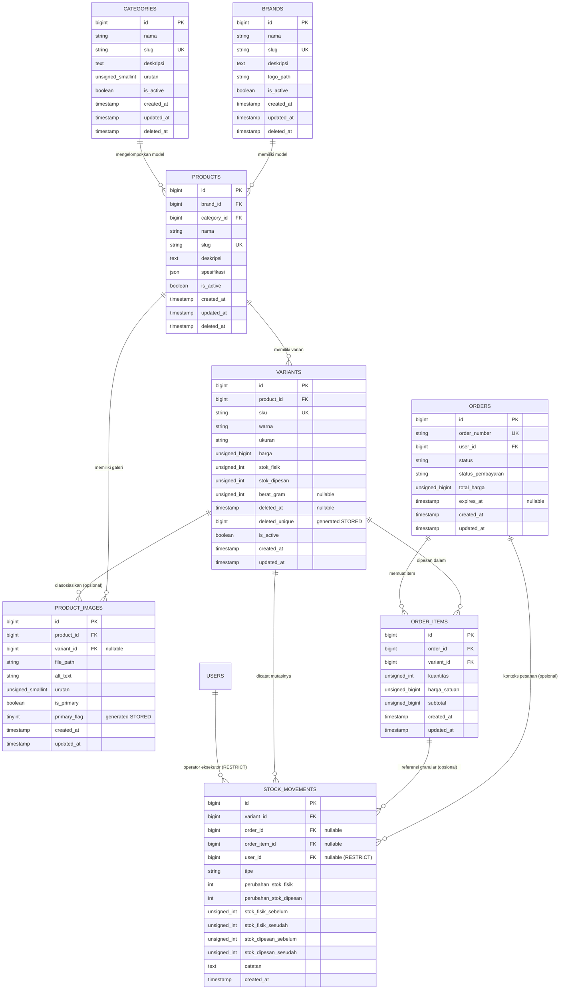

# PROPOSAL RANCANGAN DATABASE KATALOG & INVENTORY (STAGE 2)

**Proyek:** Bayeng Putra Helm
**Versi Dokumen:** 2.9 — Harmonisasi Kontrak Transaksi Koneksi Lintas Entitas (Variant, StockMovement, OrderItem, Order), Proteksi Lifecycle Pesanan & Persyaratan Transaksional PoS
**Tanggal:** 11 November 2026
**Status:** Menunggu Review & Persetujuan Pemilik Usaha / Tim Penguji

---

## Ringkasan Perubahan Versi 2.9 (Change Log)

Berdasarkan tinjauan arsitektur sistem tingkat lanjut oleh *Senior Laravel Architect & MySQL Database Reviewer*, dilakukan penyempurnaan komprehensif pada integritas batas transaksi (*transaction boundary integrity*):

1. **Perluasan Kontrak Transaksi pada `InventoryService::assertActiveTransaction()` (§5.2):**
   - Memperluas kontrak verifikasi agar memvalidasi kesamaan objek koneksi database (`!==`) secara menyeluruh untuk:
     1. Model `Variant` (sebagai basis koneksi utama inventaris: `(new Variant())->getConnection()`).
     2. Model `StockMovement` (ledger mutasi stok).
     3. Model `OrderItem` (entitas baris item pesanan: `(new OrderItem())->getConnection()`).
     4. Objek `Order` aktual yang diterima melalui parameter, jika ada (`$order->getConnection()`).
   - Memastikan verifikasi identitas objek koneksi dijalankan di awal setiap method mutasi sebelum operasi mutasi inventaris atau pengambilan data item pesanan (`$order->items()->get()`).
   - Menyediakan pesan `\LogicException` deskriptif yang secara eksplisit menyebutkan entitas mana yang memiliki ketidakcocokan koneksi.

2. **Harmonisasi Transaksi Lifecycle Pesanan Online (§6.1, §6.2, §6.3):**
   - Memperbarui pseudocode `cancelOrder`, `expireOrder`, dan `completeOrder` untuk memastikan bahwa objek koneksi `Order`, `OrderItem`, `Variant`, dan `StockMovement` diverifikasi identik sebelum transaksi dimulai.
   - Membuka transaksi atomik langsung pada objek koneksi yang telah terverifikasi (`connection.transaction(attempts: 3)`), mencegah eksekusi transaksi terpecah (*split-brain transaction*) saat `$order->items()` dievaluasi dalam proses rilis atau pemenuhan reservasi.

3. **Penetapan Persyaratan Transaksional Penjualan Toko / Walk-in PoS (§6.4):**
   - Menetapkan persyaratan implementasi wajib bahwa entitas/tabel penyimpan header penjualan PoS dan detail item penjualan PoS wajib dikonfigurasi pada objek koneksi database yang sama dengan model `Variant` dan `StockMovement`.
   - Menjamin bahwa seluruh operasi penjualan langsung (pencatatan header struk, detail item, mutasi stok fisik, dan penulisan ledger audit) terikat dalam satu unit kerja ACID atomik tanpa mengarang nama model sebelum perancangan modul PoS disahkan.

4. **Ekstensi Rencana Pengujian Otomatis Lintas-Koneksi (§11 Fase 2.5):**
   - Menambahkan spesifikasi skenario uji baru:
     1. Model `OrderItem` menggunakan koneksi berbeda dari `Variant`: ditolak sebelum mutasi (`\LogicException`).
     2. Model `OrderItem` menggunakan koneksi berbeda saat `cancelOrder`: transaksi tidak boleh berjalan (`\LogicException`).
     3. Model `OrderItem` menggunakan koneksi berbeda saat `expireOrder`: transaksi tidak boleh berjalan (`\LogicException`).
     4. Model `OrderItem` menggunakan koneksi berbeda saat `completeOrder`: transaksi tidak boleh berjalan (`\LogicException`).
     5. Seluruh model (`Order`, `OrderItem`, `Variant`, `StockMovement`) menggunakan objek koneksi yang sama: transaksi bisnis berhasil di-commit penuh.
     6. Kegagalan saat pelepasan reservasi / mutasi inventaris: status pesanan, stok, dan ledger tetap konsisten melalui rollback atomik (*zero orphaned records*).
   - Menegaskan bahwa butir-butir pengujian tersebut merupakan rencana pengujian yang wajib diimplementasikan pada Fase 2.5, bukan pengujian yang telah selesai dijalankan.

---

## 1. Ringkasan Rancangan

Stage 2 berfokus pada pembangunan fondasi database untuk **Katalog Produk** dan **Manajemen Inventory Multi-Channel (Online & Walk-in Toko)** pada sistem penjualan Bayeng Putra Helm.

### Struktur Hubungan Entitas Katalog

Berdasarkan kebutuhan bisnis, Model Produk (`products`) dinaungi secara paralel oleh dua entitas klasifikasi independen (**Merek / Brand** dan **Kategori / Category**), kemudian menurunkan variasi fisik yang dapat diperjualbelikan (**Varian / Variant**):

$$\begin{matrix} \text{Merek (Brand)} \\ \text{Kategori (Category)} \end{matrix} \mathrel{\Bigg\rightrightarrows} \text{Model Produk (Product)} \longrightarrow \text{Varian Produk (Variant)}$$

### Prinsip Utama Rancangan

1. **Pemisahan Model vs. Satuan Transaksi (Variant-Centric):**
   Model helm (misalnya *KYT TT Course*) berada di level `products`, sedangkan unit yang memiliki SKU, ukuran, warna/motif, harga, dan stok berada di level `variants`.
2. **Model Stok Dua Kolom Terisolasi (*Dual-Counter Stock Model*):**
   Memisahkan secara ketat antara **`stok_fisik`** (unit nyata di rak toko) dan **`stok_dipesan`** (unit yang sedang dicadangkan untuk pesanan online aktif). Stok tersedia dihitung secara dinamis:
   $$\text{stok\_tersedia} = \text{stok\_fisik} - \text{stok\_dipesan}$$
3. **Satu Otoritas Penulis Mutasi Inventaris (*Single Source of Truth*):**
   Seluruh operasi penulisan stok dan ledger diwajibkan melewati satu pintu: `InventoryService`.
4. **Isolasi Penuh Stok PoS Toko:**
   Penjualan walk-in di kasir toko dilarang menyentuh atau memotong unit yang sedang dicadangkan untuk pesanan online.
5. **Integritas Transaksional & Concurrency Control Terikat Koneksi:**
   Perubahan stok wajib menggunakan transaksi database atomik pada koneksi model yang konsisten dengan penguncian baris pesimistik (`lockForUpdate()`), pengurutan ID deterministik (`ORDER BY id ASC`), serta *Check Constraints* matematis di level engine MySQL 8.0.30+.
6. **Auditabilitas Total (*Immutable Stock Movement Ledger*):**
   Setiap perubahan pada `stok_fisik` maupun `stok_dipesan` wajib menghasilkan satu baris catatan riwayat yang tidak dapat diubah (*immutable log*) pada tabel `stock_movements`.
7. **Penyajian Aset Gambar Terintegrasi:**
   Memanfaatkan 50 foto helm di `storage/app/public/products/` menggunakan disk `public` Laravel Filesystem dengan jaminan integritas relasional komposit pada level database.

---

## 2. Entity-Relationship Diagram (ERD)

Diagram berikut menampilkan relasi lengkap katalog, varian, gambar, inventory, serta hubungan relasional ketat dengan modul pesanan (Stage 3):



---

## 3. Rancangan Tabel dan Kolom

### 3.1. Tabel `brands` (Merek Helm)
Menyimpan daftar merek helm resmi (KYT, INK, NHK, Cargloss, dsb.).

| Nama Kolom | Tipe Data | Atribut / Constraint | Default | Keterangan |
| :--- | :--- | :--- | :--- | :--- |
| `id` | `BIGINT UNSIGNED` | `PRIMARY KEY`, `AUTO_INCREMENT` | — | Identitas unik merek |
| `nama` | `VARCHAR(100)` | `NOT NULL` | — | Nama merek dagang (misal: "KYT") |
| `slug` | `VARCHAR(100)` | `NOT NULL`, `UNIQUE`, `INDEX` | — | Slug SEO untuk URL filter |
| `deskripsi` | `TEXT` | `NULLABLE` | `NULL` | Ringkasan profil merek |
| `logo_path` | `VARCHAR(255)` | `NULLABLE` | `NULL` | Lokasi file logo (jika ada) |
| `is_active` | `TINYINT(1)` | `NOT NULL`, `INDEX` | `1` | Status tampil di katalog publik |
| `created_at` | `TIMESTAMP` | `NULLABLE` | `NULL` | Waktu dibuat |
| `updated_at` | `TIMESTAMP` | `NULLABLE` | `NULL` | Waktu diperbarui |
| `deleted_at` | `TIMESTAMP` | `NULLABLE` | `NULL` | Penanda *Soft Delete* |

### 3.2. Tabel `categories` (Kategori / Jenis Produk)
Mengelompokkan jenis produk (Full Face, Half Face, Retro, Cross, Modular, dsb.).

| Nama Kolom | Tipe Data | Atribut / Constraint | Default | Keterangan |
| :--- | :--- | :--- | :--- | :--- |
| `id` | `BIGINT UNSIGNED` | `PRIMARY KEY`, `AUTO_INCREMENT` | — | Identitas unik kategori |
| `nama` | `VARCHAR(100)` | `NOT NULL` | — | Nama tipe helm (misal: "Full Face") |
| `slug` | `VARCHAR(100)` | `NOT NULL`, `UNIQUE`, `INDEX` | — | Slug SEO untuk URL filter |
| `deskripsi` | `TEXT` | `NULLABLE` | `NULL` | Penjelasan karakteristik tipe helm |
| `urutan` | `SMALLINT UNSIGNED`| `NOT NULL` | `0` | Urutan tampilan pada menu filter |
| `is_active` | `TINYINT(1)` | `NOT NULL`, `INDEX` | `1` | Status tampil di katalog publik |
| `created_at` | `TIMESTAMP` | `NULLABLE` | `NULL` | Waktu dibuat |
| `updated_at` | `TIMESTAMP` | `NULLABLE` | `NULL` | Waktu diperbarui |
| `deleted_at` | `TIMESTAMP` | `NULLABLE` | `NULL` | Penanda *Soft Delete* |

### 3.3. Tabel `products` (Model Produk Helm)
Mewakili induk seri helm (misal: "TT Course", "Centro", "CF Retro").

| Nama Kolom | Tipe Data | Atribut / Constraint | Default | Keterangan |
| :--- | :--- | :--- | :--- | :--- |
| `id` | `BIGINT UNSIGNED` | `PRIMARY KEY`, `AUTO_INCREMENT` | — | Identitas unik model produk |
| `brand_id` | `BIGINT UNSIGNED` | `NOT NULL`, `INDEX`, `FK` | — | Relasi ke `brands.id` (`RESTRICT`) |
| `category_id` | `BIGINT UNSIGNED` | `NOT NULL`, `INDEX`, `FK` | — | Relasi ke `categories.id` (`RESTRICT`) |
| `nama` | `VARCHAR(150)` | `NOT NULL` | — | Nama seri produk (misal: "TT Course") |
| `slug` | `VARCHAR(160)` | `NOT NULL`, `UNIQUE`, `INDEX` | — | Slug unik halaman detail produk |
| `deskripsi` | `TEXT` | `NULLABLE` | `NULL` | Deskripsi pemasaran & keunggulan |
| `spesifikasi` | `JSON` | `NULLABLE` | `NULL` | Atribut teknis (material shell, tali, SNI) |
| `is_active` | `TINYINT(1)` | `NOT NULL`, `INDEX` | `1` | Visibilitas produk di katalog |
| `created_at` | `TIMESTAMP` | `NULLABLE` | `NULL` | Waktu dibuat |
| `updated_at` | `TIMESTAMP` | `NULLABLE` | `NULL` | Waktu diperbarui |
| `deleted_at` | `TIMESTAMP` | `NULLABLE` | `NULL` | Penanda *Soft Delete* |

### 3.4. Tabel `variants` (Varian Produk, Harga, & Stok)
Unit transaksi dan inventaris terkecil. Kombinasi model, warna/motif, dan ukuran.

| Nama Kolom | Tipe Data | Atribut / Constraint | Default | Keterangan |
| :--- | :--- | :--- | :--- | :--- |
| `id` | `BIGINT UNSIGNED` | `PRIMARY KEY`, `AUTO_INCREMENT` | — | Identitas unik SKU varian |
| `product_id` | `BIGINT UNSIGNED` | `NOT NULL`, `INDEX`, `FK` | — | Relasi ke `products.id` (`RESTRICT`) |
| `sku` | `VARCHAR(60)` | `NOT NULL`, `UNIQUE`, `INDEX` | — | Stock Keeping Unit unik (misal: `KYT-TTC-MB-L`) |
| `warna` | `VARCHAR(100)` | `NOT NULL` | — | Nama warna/motif (misal: "Matt Black", "Dalla Porta") |
| `ukuran` | `VARCHAR(20)` | `NOT NULL` | — | Ukuran helm ("S", "M", "L", "XL", "XXL", "All Size") |
| `harga` | `BIGINT UNSIGNED` | `NOT NULL`, `CHECK (harga > 0 AND harga <= 9223372036854775807)` | — | Harga jual dalam Rupiah utuh (aman kapasitas PHP 64-bit) |
| `stok_fisik` | `INT UNSIGNED` | `NOT NULL` | `0` | Jumlah unit fisik di rak toko |
| `stok_dipesan` | `INT UNSIGNED` | `NOT NULL` | `0` | Jumlah unit yang sedang direservasi online |
| `berat_gram` | `INT UNSIGNED` | `NULLABLE` | `NULL` | Berat riil helm (gram), murni nullable tanpa default sembarang |
| `deleted_at` | `TIMESTAMP` | `NULLABLE` | `NULL` | Penanda *Soft Delete* (didefinisikan sebelum generated column) |
| `deleted_unique` | `BIGINT UNSIGNED` | `GENERATED ALWAYS AS (IF(deleted_at IS NULL, 0, id)) STORED` | — | Kolom virtual penjamin keunikan data aktif |
| `is_active` | `TINYINT(1)` | `NOT NULL`, `INDEX` | `1` | Status varian dapat dipilih/dipesan |
| `created_at` | `TIMESTAMP` | `NULLABLE` | `NULL` | Waktu dibuat |
| `updated_at` | `TIMESTAMP` | `NULLABLE` | `NULL` | Waktu diperbarui |

**Check Constraints & Composite Keys pada `variants`:**
```sql
ALTER TABLE variants
ADD CONSTRAINT uk_variants_id_product
UNIQUE (id, product_id);

ALTER TABLE variants
ADD CONSTRAINT chk_variants_stok_valid
CHECK (stok_fisik >= stok_dipesan);
```

### 3.5. Tabel `product_images` (Foto Produk & Galeri)
Menghubungkan berkas gambar fisik dengan produk dan/atau varian warna tertentu.

| Nama Kolom | Tipe Data | Atribut / Constraint | Default | Keterangan |
| :--- | :--- | :--- | :--- | :--- |
| `id` | `BIGINT UNSIGNED` | `PRIMARY KEY`, `AUTO_INCREMENT` | — | Identitas unik foto |
| `product_id` | `BIGINT UNSIGNED` | `NOT NULL`, `INDEX`, `FK` | — | Relasi ke `products.id` (`CASCADE`) |
| `variant_id` | `BIGINT UNSIGNED` | `NULLABLE`, `INDEX` | `NULL` | Relasi opsional ke varian produk yang sama |
| `file_path` | `VARCHAR(255)` | `NOT NULL` | — | Path relatif di storage (misal: `products/kyt_tt_corse.jpg`) |
| `alt_text` | `VARCHAR(255)` | `NOT NULL` | — | Deskripsi aksesibilitas & SEO (wajib diisi/fallback) |
| `urutan` | `SMALLINT UNSIGNED`| `NOT NULL` | `0` | Urutan tampilan pada galeri produk |
| `is_primary` | `TINYINT(1)` | `NOT NULL`, `INDEX` | `0` | Penanda foto cover utama produk (`1` = cover, didefinisikan awal) |
| `primary_flag` | `TINYINT(1)` | `GENERATED ALWAYS AS (IF(is_primary = 1, 1, NULL)) STORED` | — | Kolom virtual penjamin tunggal foto utama |
| `created_at` | `TIMESTAMP` | `NULLABLE` | `NULL` | Waktu dibuat |
| `updated_at` | `TIMESTAMP` | `NULLABLE` | `NULL` | Waktu diperbarui |

### 3.6. Tabel `stock_movements` (Buku Besar Pergerakan Stok)
Pencatatan riwayat perubahan stok yang tidak dapat diubah (*immutable ledger*).

| Nama Kolom | Tipe Data | Atribut / Constraint | Default | Keterangan |
| :--- | :--- | :--- | :--- | :--- |
| `id` | `BIGINT UNSIGNED` | `PRIMARY KEY`, `AUTO_INCREMENT` | — | Identitas unik log pergerakan stok |
| `variant_id` | `BIGINT UNSIGNED` | `NOT NULL`, `INDEX`, `FK` | — | Relasi ke `variants.id` (`RESTRICT`) |
| `order_id` | `BIGINT UNSIGNED` | `NULLABLE`, `INDEX` | `NULL` | Relasi ke `orders.id` (FK ditambahkan di Stage 3) |
| `order_item_id` | `BIGINT UNSIGNED` | `NULLABLE`, `INDEX` | `NULL` | Relasi ke `order_items.id` (FK ditambahkan di Stage 3) |
| `user_id` | `BIGINT UNSIGNED` | `NULLABLE`, `INDEX`, `FK` | `NULL` | Operator eksekutor (`users.id`, `ON DELETE RESTRICT`) |
| `tipe` | `VARCHAR(40)` | `NOT NULL`, `INDEX` | — | Jenis mutasi (`masuk`, `keluar_pos`, `reservasi_masuk`, dsb.) |
| `perubahan_stok_fisik` | `INT` | `NOT NULL` | `0` | Delta stok fisik (+ / -) |
| `perubahan_stok_dipesan` | `INT` | `NOT NULL` | `0` | Delta stok dipesan (+ / -) |
| `stok_fisik_sebelum` | `INT UNSIGNED` | `NOT NULL` | — | Saldo stok fisik sebelum transaksi |
| `stok_fisik_sesudah` | `INT UNSIGNED` | `NOT NULL` | — | Saldo stok fisik sesudah transaksi |
| `stok_dipesan_sebelum` | `INT UNSIGNED` | `NOT NULL` | — | Saldo dipesan sebelum transaksi |
| `stok_dipesan_sesudah` | `INT UNSIGNED` | `NOT NULL` | — | Saldo dipesan sesudah transaksi |
| `catatan` | `TEXT` | `NULLABLE` | `NULL` | Alasan mutasi / keterangan audit operasional |
| `created_at` | `TIMESTAMP` | `NOT NULL` | `CURRENT_TIMESTAMP` | Waktu mutasi terjadi (tidak ada `updated_at`) |

### 3.7. Tabel Terkait Stage 3 (Pesanan & Item Pesanan)

#### Tabel `orders` (Header Pesanan - Stage 3)
| Nama Kolom | Tipe Data | Atribut / Constraint | Default | Keterangan |
| :--- | :--- | :--- | :--- | :--- |
| `id` | `BIGINT UNSIGNED` | `PRIMARY KEY`, `AUTO_INCREMENT` | — | Identitas unik pesanan |
| `order_number` | `VARCHAR(64)` | `NOT NULL`, `UNIQUE`, `INDEX` | — | Format: `ORD-YYYYMMDD-[ULID]` |
| `user_id` | `BIGINT UNSIGNED` | `NOT NULL`, `INDEX`, `FK` | — | Relasi ke `users.id` (`RESTRICT`) |
| `status` | `VARCHAR(30)` | `NOT NULL`, `INDEX` | `'dibuat'` | Status pesanan |
| `status_pembayaran`| `VARCHAR(30)` | `NOT NULL`, `INDEX` | `'belum_dibayar'` | Status pembayaran terpisah |
| `total_harga` | `BIGINT UNSIGNED` | `NOT NULL`, `CHECK (total_harga > 0 AND total_harga <= 9223372036854775807)` | — | Total pesanan dalam Rupiah utuh |
| `expires_at` | `TIMESTAMP` | `NULLABLE`, `INDEX` | `NULL` | Batas waktu kedaluwarsa reservasi (UTC) |
| `created_at` | `TIMESTAMP` | `NULLABLE` | `NULL` | Waktu dibuat |
| `updated_at` | `TIMESTAMP` | `NULLABLE` | `NULL` | Waktu diperbarui |

#### Tabel `order_items` (Rincian Item Pesanan - Stage 3)
| Nama Kolom | Tipe Data | Atribut / Constraint | Default | Keterangan |
| :--- | :--- | :--- | :--- | :--- |
| `id` | `BIGINT UNSIGNED` | `PRIMARY KEY`, `AUTO_INCREMENT` | — | Identitas unik baris item |
| `order_id` | `BIGINT UNSIGNED` | `NOT NULL`, `INDEX`, `FK` | — | Relasi ke `orders.id` (`CASCADE`) |
| `variant_id` | `BIGINT UNSIGNED` | `NOT NULL`, `INDEX`, `FK` | — | Relasi ke `variants.id` (`RESTRICT`) |
| `kuantitas` | `INT UNSIGNED` | `NOT NULL`, `CHECK (kuantitas >= 1 AND kuantitas <= 999)` | — | Jumlah unit (1 s.d. 999 per baris) |
| `harga_satuan` | `BIGINT UNSIGNED` | `NOT NULL`, `CHECK (harga_satuan > 0 AND harga_satuan <= 9223372036854775807)` | — | Snapshot harga satuan saat transaksi |
| `subtotal` | `BIGINT UNSIGNED` | `NOT NULL`, `CHECK (subtotal > 0 AND subtotal <= 9223372036854775807)` | — | Snapshot perkalian harga $\times$ kuantitas |
| `created_at` | `TIMESTAMP` | `NULLABLE` | `NULL` | Waktu dibuat |
| `updated_at` | `TIMESTAMP` | `NULLABLE` | `NULL` | Waktu diperbarui |

---

## 4. Analisis Mendalam Relasi, Constraints, dan Keamanan Data

### 4.1. Unique Constraint Varian pada Soft Delete (Stored Generated Column)
#### Permasalahan Standar SQL & MySQL:
Pada MySQL, indeks `UNIQUE(product_id, warna, ukuran, deleted_at)` memiliki kelemahan fatal: sesuai standar SQL, **`NULL != NULL`** (nilai NULL dianggap distinct/tidak sama). Akibatnya, jika ada banyak baris aktif yang sama-sama memiliki `deleted_at = NULL` dengan `(product_id, warna, ukuran)` identik, MySQL mengizinkan seluruh baris tersebut. Unique constraint konvensional sama sekali **gagal melindungi data aktif dari duplikasi**!

#### Solusi yang Ditetapkan (Generated Stored Column):
Perhatikan bahwa pada skema migration, kolom sumber `deleted_at` **wajib didefinisikan terlebih dahulu** sebelum kolom turunan `deleted_unique`:
```sql
ALTER TABLE variants
ADD COLUMN deleted_unique BIGINT UNSIGNED
GENERATED ALWAYS AS (IF(deleted_at IS NULL, 0, id)) STORED;

ALTER TABLE variants
ADD CONSTRAINT uk_variants_active_combination
UNIQUE (product_id, warna, ukuran, deleted_unique);
```

#### Cara Kerja & Konsekuensi Restore:
1. **Untuk Data Aktif (`deleted_at IS NULL`):** Nilai `deleted_unique` selalu dievaluasi menjadi nilai skalar **`0`**. Karena `0` adalah nilai pasti (non-NULL), MySQL menegakkan aturan keunikan: dalam satu produk, **hanya boleh ada tepat satu kombinasi warna dan ukuran dengan nilai `0`**. Upaya membuat varian aktif kedua dengan warna dan ukuran yang sama langsung ditolak MySQL dengan error code `1062 Duplicate entry`.
2. **Untuk Data Terhapus Lunak (*Soft Deleted*, `deleted_at IS NOT NULL`):** Nilai `deleted_unique` dievaluasi menjadi **`id`** (kunci utama baris tersebut yang pasti unik).
3. **Konsekuensi Restore:** Jika varian lama dipulihkan padahal kombinasi aktif sudah ada, MySQL melempar error 1062. Service aplikasi wajib memvalidasi ketiadaan kombinasi aktif sebelum memanggil `$variant->restore()`.

---

### 4.2. Penjaminan Integritas Foto Produk (`product_images`)

#### A. Aturan Tunggal Foto Utama (*One Primary Image per Product*)
Memanfaatkan sifat bahwa MySQL mengizinkan nilai `NULL` ganda pada unique index. Kolom sumber `is_primary` didefinisikan sebelum `primary_flag`:
```sql
ALTER TABLE product_images
ADD COLUMN primary_flag TINYINT(1)
GENERATED ALWAYS AS (IF(is_primary = 1, 1, NULL)) STORED;

ALTER TABLE product_images
ADD CONSTRAINT uk_product_single_primary_image
UNIQUE (product_id, primary_flag);
```

#### B. Foto Utama Produk Wajib Memiliki `variant_id = NULL`
Untuk memastikan foto utama murni merepresentasikan produk secara keseluruhan (cover kartu katalog umum), ditambahkan *Check Constraint*:
```sql
ALTER TABLE product_images
ADD CONSTRAINT chk_primary_image_has_no_variant
CHECK (is_primary = 0 OR (is_primary = 1 AND variant_id IS NULL));
```

#### C. Composite Foreign Key: Evaluasi `ON DELETE RESTRICT`
Pada varian foto, foreign key dirancang komposit dengan `RESTRICT`:
1. Pada tabel `variants`, dibuat *Composite Unique Key*:
   ```sql
   ALTER TABLE variants
   ADD CONSTRAINT uk_variants_id_product
   UNIQUE (id, product_id);
   ```
2. Pada tabel `product_images`, relasi foreign key dibuat komposit dengan `RESTRICT`:
   ```sql
   ALTER TABLE product_images
   ADD CONSTRAINT fk_product_images_variant_product
   FOREIGN KEY (variant_id, product_id)
   REFERENCES variants(id, product_id)
   ON DELETE RESTRICT;
   ```
   *Alasan RESTRICT:* Pada `product_images`, `product_id` bersifat `NOT NULL`. Aksi `ON DELETE SET NULL` pada foreign key komposit akan berusaha men-NULL-kan seluruh kolom komposit, yang langsung digagalkan oleh MySQL karena `product_id` dilarang NULL. Dengan `RESTRICT`, varian yang memiliki foto tidak dapat dihapus sebelum tautan foto dilepas oleh aplikasi.

#### D. Mekanisme Pembersihan File Fisik yang Aman (Post-Commit Hook)
Penghapusan file fisik hanya dieksekusi setelah transaksi database berhasil di-commit penuh:
```php
DB::transaction(function () use ($image) {
    $filePath = $image->file_path;
    $image->delete();

    DB::afterCommit(function () use ($filePath) {
        Storage::disk('public')->delete($filePath);
    });
});
```

---

### 4.3. Penyelarasan Batas Keuangan `BIGINT UNSIGNED` dengan PHP 64-bit

#### Masalah Representasi Tipe Data:
- Tipe `BIGINT UNSIGNED` pada MySQL mampu menyimpan nilai hingga $18.446.744.073.709.551.615$ ($2^{64}-1$).
- PHP pada platform 64-bit (`PHP_INT_SIZE === 8`) merepresentasikan integer bertanda (*signed*) dengan nilai maksimum `PHP_INT_MAX` = $9.223.372.036.854.775.807$ ($2^{63}-1$).
- Jika database menyimpan angka di atas `PHP_INT_MAX`, driver PDO PHP akan mengembalikannya sebagai *numeric string*. Begitu string tersebut dipaksa cast `(int)` atau terlibat operasi aritmetika non-ketat, PHP mengonversinya secara diam-diam menjadi `float`, yang memicu **kehilangan presisi (*silent precision loss*)**.

#### Solusi Database Constraints:
Menetapkan batas atas representasi integer finansial yang aman di database:
```sql
ALTER TABLE variants
ADD CONSTRAINT chk_variants_harga_safe
CHECK (harga > 0 AND harga <= 9223372036854775807);

ALTER TABLE orders
ADD CONSTRAINT chk_orders_total_harga_safe
CHECK (total_harga > 0 AND total_harga <= 9223372036854775807);

ALTER TABLE order_items
ADD CONSTRAINT chk_order_items_nominal_safe
CHECK (
    harga_satuan > 0 AND harga_satuan <= 9223372036854775807
    AND
    subtotal > 0 AND subtotal <= 9223372036854775807
);
```

---

### 4.4. Integritas Relasional, Invariant Buku Besar, dan Kesinambungan Rantai Riwayat (`stock_movements`)

#### A. Penjaminan Relasi Pesanan dan Varian Terpadu (Stage 3)
```sql
ALTER TABLE order_items
ADD CONSTRAINT uk_order_items_composite
UNIQUE (id, order_id, variant_id);

ALTER TABLE stock_movements
ADD CONSTRAINT fk_stock_movements_order_item_composite
FOREIGN KEY (order_item_id, order_id, variant_id)
REFERENCES order_items(id, order_id, variant_id)
ON DELETE RESTRICT;
```

#### B. Constraint Konsistensi Referensi Pesanan
```sql
ALTER TABLE stock_movements
ADD CONSTRAINT chk_stock_movements_order_reference_consistency
CHECK (
    (order_id IS NULL AND order_item_id IS NULL)
    OR
    (order_id IS NOT NULL AND order_item_id IS NOT NULL)
);
```

#### C. Invariant Saldo Ledger Lengkap (Safe Numeric Casting)
Memvalidasi persamaan delta dan memastikan bahwa baik saldo awal maupun saldo akhir tidak pernah melanggar aturan invariant stok tersedia ($\text{stok\_fisik} \ge \text{stok\_dipesan}$):
```sql
ALTER TABLE stock_movements
ADD CONSTRAINT chk_stock_movements_math_consistency
CHECK (
    (CAST(stok_fisik_sebelum AS SIGNED) + CAST(perubahan_stok_fisik AS SIGNED) = CAST(stok_fisik_sesudah AS SIGNED))
    AND
    (CAST(stok_dipesan_sebelum AS SIGNED) + CAST(perubahan_stok_dipesan AS SIGNED) = CAST(stok_dipesan_sesudah AS SIGNED))
    AND
    (perubahan_stok_fisik != 0 OR perubahan_stok_dipesan != 0)
    AND
    (stok_fisik_sebelum >= stok_dipesan_sebelum)
    AND
    (stok_fisik_sesudah >= stok_dipesan_sesudah)
);
```

#### D. Penjelasan Komprehensif Kesinambungan Rantai Riwayat (*Cross-Row Chain Continuity*)
Integritas buku besar stok (`stock_movements`) ditegakkan melalui sinergi 3 pilar arsitektur:

1. **Invariant Baris Individual (*Single-Row Invariant* - Database Engine Level):**
   *Check constraint* `chk_stock_movements_math_consistency` dievaluasi oleh engine MySQL pada setiap baris yang dimasukkan. Constraint ini menjamin:
   - Delta mutasi bukan nol.
   - Matematika saldo sebelum ditambah delta tepat sama dengan saldo sesudah.
   - Saldo sebelum dan saldo sesudah mematuhi hukum $\text{stok\_fisik} \ge \text{stok\_dipesan}$.
   Constraint ini memvalidasi integritas baris secara individual, namun tidak memeriksa record sebelumnya karena batasan scope evaluasi baris tunggal SQL standar.

2. **Kesinambungan Antar-Baris (*Cross-Row Chain Continuity* - Application & Transaction Level):**
   Jaminan bahwa saldo awal mutasi ke-$N$ identik dengan saldo akhir mutasi ke-$(N-1)$ ditegakkan melalui disiplin transaksi:
   - **Pessimistic Row Locking (`lockForUpdate()`):** Baris varian terkait dikunci secara eksklusif dalam transaksi database ACID. Tidak ada proses konkuren lain yang dapat membaca atau memodifikasi saldo varian tersebut hingga transaksi aktif selesai.
   - **Atomic Read-Modify-Write:** Nilai saldo awal pada entri ledger diambil langsung dari nilai mutakhir model varian yang terkunci (`$variant->stok_fisik` dan `$variant->stok_dipesan`).
   - **Satu Pintu Otoritas Penulis Mutasi (`InventoryService`):** Seluruh mutasi inventaris (checkout online, pelunasan PoS toko, pembatalan, kedaluwarsa, restok barang masuk, dan audit opname) **wajib melalui `InventoryService`**. Dilarang keras melakukan eksekusi raw query atau update langsung ke tabel `variants` maupun `stock_movements` di luar service ini.
   - **Sinkronisasi Atomik:** Pembaruan saldo pada model `Variant` dan penyimpanan record pada `StockMovement` dilakukan dalam transaksi database yang sama pada koneksi model yang konsisten. Jika salah satu gagal, seluruh operasi dibatalkan (*rollback*).

3. **Kekekalan Riwayat (*Data Immutability* - Trigger & Security Privilege Level):**
   Rantai riwayat tidak dapat dipotong atau disisipi secara ilegal karena:
   - MySQL Triggers memblokir seluruh operasi `UPDATE` dan `DELETE`.
   - User database runtime aplikasi (`bayeng_app`) tidak diberikan hak privilege `UPDATE` maupun `DELETE` pada tabel `stock_movements`.

---

### 4.5. Pertahanan Identitas Operator Historis (`user_id ON DELETE RESTRICT`)
```sql
ALTER TABLE stock_movements
ADD CONSTRAINT fk_stock_movements_user
FOREIGN KEY (user_id) REFERENCES users(id)
ON DELETE RESTRICT;
```
- Aksi referensial otomatis InnoDB (`SET NULL`) dieksekusi internal dan **tidak memicu triggers**. Menggunakan `ON DELETE SET NULL` akan merusak data audit tanpa dapat dicegah oleh trigger.
- Dengan `RESTRICT`, akun pengguna yang memiliki rekam jejak mutasi dilarang di-hard-delete. Pengelolaan siklus akun wajib menggunakan *Soft Deletes* atau penonaktifan (`is_active = false`).

---

### 4.6. Diferensiasi Konseptual Keamanan Ledger: Immutability, Integrity, dan Authenticity

| Pilar Keamanan | Definisi | Ancaman yang Dicegah | Mekanisme Penegakan Teknis |
| :--- | :--- | :--- | :--- |
| **1. Immutability** (*Ketidakdapatubahan*) | Catatan yang sudah tersimpan ke dalam database tidak dapat diubah nilainya atau dihapus selamanya. | Manipulasi riwayat audit masa lalu untuk menutupi selisih fisik toko. | - MySQL Triggers (`BEFORE UPDATE` & `BEFORE DELETE` melempar SQLSTATE 45000).<br>- Akun DB runtime `bayeng_app` tanpa hak `UPDATE` dan `DELETE`.<br>- Eloquent Model `$guarded = ['*']` dan event blocker. |
| **2. Integrity** (*Keutuhan Data*) | Saldo, delta mutasi, dan relasi transaksi selalu konsisten dan mematuhi hukum matematika. | Ketidakseimbangan saldo, angka negatif, atau mutasi mengambang tanpa pesanan yang sah. | - MySQL Check Constraints matematis (`CAST(...)`).<br>- Composite Foreign Key ke `order_items`.<br>- Database Transactions atomik (`$connection->transaction`). |
| **3. Authenticity** (*Keabsahan Asal-Usul*) | Setiap record baru yang masuk benar-benar berasal dari alur bisnis operasional resmi yang sah. | Penyelundupan baris ledger palsu melalui celah bypass aplikasi atau SQL Injection. | - Jalur penulisan terenkapsulasi (**`InventoryService`** sebagai Single Source of Truth).<br>- Otorisasi ketat berbasis Laravel Policy (RBAC).<br>- Verifikasi status stok dan lock pesanan sebelum insert. |

---

### 4.7. Implementasi Migration Trigger Laravel Murni (PDO Compatible)
```php
use Illuminate\Database\Migrations\Migration;
use Illuminate\Support\Facades\DB;

return new class extends Migration
{
    public function up(): void
    {
        DB::unprepared('
            CREATE TRIGGER trg_stock_movements_prevent_update
            BEFORE UPDATE ON stock_movements
            FOR EACH ROW
            BEGIN
                SIGNAL SQLSTATE \'45000\'
                SET MESSAGE_TEXT = \'Security Violation: Tabel stock_movements bersifat immutable. UPDATE dilarang.\';
            END
        ');

        DB::unprepared('
            CREATE TRIGGER trg_stock_movements_prevent_delete
            BEFORE DELETE ON stock_movements
            FOR EACH ROW
            BEGIN
                SIGNAL SQLSTATE \'45000\'
                SET MESSAGE_TEXT = \'Security Violation: Tabel stock_movements bersifat immutable. DELETE dilarang.\';
            END
        ');
    }

    public function down(): void
    {
        DB::unprepared('DROP TRIGGER IF EXISTS trg_stock_movements_prevent_update');
        DB::unprepared('DROP TRIGGER IF EXISTS trg_stock_movements_prevent_delete');
    }
};
```

---

### 4.8. Aturan Isolasi Stok untuk Penjualan Langsung Toko / Walk-in PoS
Sesuai PRD Bab 5.2, sistem membedakan secara ketat antara penjualan langsung di toko fisik (PoS) dan pesanan online pickup:
- **Prinsip Utama:** Penjualan langsung kasir toko **dilarang keras mengambil stok yang sedang dicadangkan untuk pesanan online**.
- **Kapasitas Penjualan PoS:**
  $$\text{stok\_tersedia\_pos} = \text{stok\_fisik} - \text{stok\_dipesan}$$
- **Syarat Mutlak Transaksi PoS:**
  $$\text{kuantitas\_jual} \le \text{stok\_fisik} - \text{stok\_dipesan}$$
- **Dampak Transaksi PoS Berhasil:**
  - `stok_fisik` berkurang sebesar kuantitas yang dibeli pembeli langsung.
  - `stok_dipesan` **TIDAK BERUBAH** (karena transaksi PoS bukan berasal dari reservasi online).
  - Mutasi ledger dicatat dengan tipe `keluar_pos`, `perubahan_stok_fisik = -$qty`, dan `perubahan_stok_dipesan = 0`.
- **Penolakan Transaksi:** Jika seorang pembeli walk-in ingin membeli 3 unit helm, sedangkan toko memiliki 4 unit fisik namun 2 di antaranya sudah direservasi pesanan online (tersedia PoS = $4 - 2 = 2$), maka transaksi PoS wajib ditolak dengan `InsufficientStockException`. Helm yang sudah direservasi online tidak boleh dijual kepada pelanggan walk-in.

---

### 4.9. Standardisasi Waktu Sistem (UTC Database vs. WIB Bisnis)
Untuk mencegah *timezone drift*, inkonsistensi perbandingan tanggal, dan kerancuan audit:
1. **Penyimpanan Database (UTC):**
   - Seluruh kolom berjenis `TIMESTAMP` (`created_at`, `updated_at`, `expires_at`, `stock_movements.created_at`) disimpan dalam basis **UTC** (`+00:00`).
   - Koneksi MySQL pada `config/database.php` wajib dikonfigurasi dengan `'timezone' => '+00:00'`. Dengan demikian, fungsi engine MySQL seperti `NOW()` atau `CURRENT_TIMESTAMP` menghasilkan waktu UTC yang konsisten dengan PHP `Carbon::now('UTC')`.
2. **Perhitungan Waktu Kedaluwarsa (UTC):**
   - Kolom `orders.expires_at` dihitung berdasarkan waktu UTC: `Carbon::now('UTC')->addHours($ttlHours)`.
   - Query scheduler memeriksa kedaluwarsa secara native di database: `WHERE expires_at IS NOT NULL AND expires_at <= NOW()`. Karena session MySQL berada pada UTC, evaluasi perbandingan waktu dijamin 100% akurat.
3. **Penanggalan Bisnis Nomor Pesanan (WIB):**
   - Toko fisik Bayeng Putra Helm beroperasi di Kuningan, Jawa Barat (Zona Waktu Indonesia Barat / UTC+7).
   - Penomoran pesanan (`order_number`) mencerminkan tanggal transaksi bisnis lokal:
     `$wibDate = Carbon::now('Asia/Jakarta')->format('Ymd');`
     `$orderNumber = "ORD-{$wibDate}-{$ulidToken}";`
4. **Tampilan Pengguna (WIB):**
   - Konversi waktu ke `Asia/Jakarta` dilakukan secara eksklusif pada layer presentasi (Blade views atau model accessor) untuk kenyamanan pengguna lokal.

---

## 5. Transaksi Inventory dan Concurrency Control

### 5.1. Analisis Concurrency dan Pengurutan ID Varian
- Pengurutan ID varian secara deterministik (`ORDER BY id ASC`) **mengeliminasi potensi *cyclic wait deadlock* antar-baris varian**. Namun, potensi deadlock lain di level index gap-lock, baris pesanan, atau metadata lock tetap dapat terjadi pada konkurensi tinggi.
- Digabungkan dengan mekanisme *retry* otomatis bawaan Laravel: `$connection->transaction(..., attempts: 3)`.

---

### 5.2. Otoritas Tunggal Mutasi Inventaris & Kontrak Transaksi Koneksi Spesifik (`InventoryService`)

`InventoryService` adalah satu-satunya kelas dalam aplikasi yang berwenang memodifikasi kolom stok pada model `Variant` dan menulis catatan pada tabel `stock_movements`.

#### Alasan Teknis Pemilihan Koneksi & Manajemen Koneksi Model Laravel
Di Laravel, setiap model Eloquent me-resolve instance koneksi melalui `ConnectionResolverInterface`. Jika transaksi dibuka secara generik melalui `DB::transaction()` tanpa argumen nama koneksi, transaksi hanya aktif pada koneksi default (`config('database.default')`). Apabila model dikonfigurasi menggunakan koneksi spesifik (misalnya `$connection = 'mysql_catalog'`), maka mutasi pada model tersebut dieksekusi di luar transaksi default dalam mode `autocommit` MySQL. Akibatnya, kegagalan pada operasi lain tidak akan me-rollback mutasi varian atau ledger tersebut.

Oleh karena itu, arsitektur Bayeng Putra Helm mewajibkan:
1. Seluruh model dalam satu alur bisnis transaksi (`Order`, `OrderItem`, `Variant`, dan `StockMovement`) **wajib menggunakan objek koneksi database yang sama persis**.
2. Metode mutasi pada `InventoryService` memverifikasi secara ketat bahwa transaksi aktif berada pada koneksi model yang bersangkutan, serta memvalidasi bahwa model `StockMovement`, `OrderItem`, dan objek `Order` yang diterimanya terikat pada objek koneksi yang sama persis.

```php
namespace App\Services\Inventory;

use App\Models\Order;
use App\Models\OrderItem;
use App\Models\Variant;
use App\Models\StockMovement;
use Illuminate\Database\ConnectionInterface;

class InventoryService
{
    /**
     * Memastikan transaksi database aktif pada koneksi yang sama persis
     * antara model Variant, StockMovement, OrderItem, dan objek Order yang terlibat.
     */
    protected function assertActiveTransaction(?Order $order = null): ConnectionInterface
    {
        $variantConnection = (new Variant())->getConnection();
        $connectionName = $variantConnection->getName() ?: 'default';

        // 1. Verifikasi transaksi aktif pada objek koneksi model Variant
        if ($variantConnection->transactionLevel() === 0) {
            throw new \LogicException(
                "Pelanggaran Kontrak Arsitektur: Method mutasi inventaris pada InventoryService " .
                "wajib dieksekusi di dalam transaksi database aktif pada koneksi '{$connectionName}'."
            );
        }

        // 2. Verifikasi kesamaan objek koneksi dengan model StockMovement
        $ledgerConnection = (new StockMovement())->getConnection();
        if ($ledgerConnection !== $variantConnection) {
            throw new \LogicException(
                "Inkonsistensi Konfigurasi: Model Variant (koneksi: '{$variantConnection->getName()}') " .
                "dan StockMovement (koneksi: '{$ledgerConnection->getName()}') wajib menggunakan objek koneksi database yang sama persis."
            );
        }

        // 3. Verifikasi kesamaan objek koneksi dengan model OrderItem
        $orderItemConnection = (new OrderItem())->getConnection();
        if ($orderItemConnection !== $variantConnection) {
            throw new \LogicException(
                "Inkonsistensi Konfigurasi: Model Variant (koneksi: '{$variantConnection->getName()}') " .
                "dan OrderItem (koneksi: '{$orderItemConnection->getName()}') wajib menggunakan objek koneksi database yang sama persis."
            );
        }

        // 4. Verifikasi kesamaan objek koneksi dengan model Order (jika konteks operasi melibatkan pesanan)
        if ($order !== null) {
            $orderConnection = $order->getConnection();
            if ($orderConnection !== $variantConnection) {
                throw new \LogicException(
                    "Pelanggaran Batas Transaksi: Objek Order #{$order->id} terikat pada koneksi '{$orderConnection->getName()}', " .
                    "berbeda dari koneksi inventory '{$variantConnection->getName()}'. Seluruh entitas pesanan (Order, OrderItem) dan inventaris (Variant, StockMovement) wajib berada pada objek koneksi yang sama."
                );
            }
        }

        return $variantConnection;
    }

    /**
     * Reservasi stok untuk pesanan online baru (Checkout)
     */
    public function reserveStockForOrder(Order $order, array $itemsPreparation, int $userId): void
    {
        $this->assertActiveTransaction($order);

        $sortedVariantIds = array_column($itemsPreparation, 'variant_id');
        sort($sortedVariantIds, SORT_NUMERIC);

        // Kunci baris varian secara menaik (ASC) pada koneksi yang sama
        $lockedVariants = Variant::whereIn('id', $sortedVariantIds)
            ->orderBy('id', 'asc')
            ->lockForUpdate()
            ->get()
            ->keyBy('id');

        foreach ($itemsPreparation as $item) {
            $variantId = $item['variant_id'];
            $qty = $item['qty'];
            $orderItemId = $item['order_item_id'];

            /** @var Variant $variant */
            $variant = $lockedVariants->get($variantId);

            $stokTersedia = $variant->stok_fisik - $variant->stok_dipesan;
            if ($stokTersedia < $qty) {
                throw new \DomainException("Stok helm {$variant->sku} tidak mencukupi saat proses reservasi.");
            }

            $fisikSebelum = $variant->stok_fisik;
            $dipesanSebelum = $variant->stok_dipesan;

            // Naikkan stok dipesan (reservasi online)
            $variant->stok_dipesan += $qty;
            $variant->save();

            StockMovement::createLedgerEntry([
                'variant_id' => $variant->id,
                'order_id' => $order->id,
                'order_item_id' => $orderItemId,
                'user_id' => $userId,
                'tipe' => 'reservasi_masuk',
                'perubahan_stok_fisik' => 0,
                'perubahan_stok_dipesan' => $qty,
                'stok_fisik_sebelum' => $fisikSebelum,
                'stok_fisik_sesudah' => $fisikSebelum,
                'stok_dipesan_sebelum' => $dipesanSebelum,
                'stok_dipesan_sesudah' => $dipesanSebelum + $qty,
                'catatan' => "Reservasi pesanan online #{$order->order_number}",
            ]);
        }
    }

    /**
     * Pelepasan reservasi stok (Pembatalan Pembeli/Staf atau Kedaluwarsa Otomatis)
     */
    public function releaseReservationForOrder(Order $order, ?int $operatorUserId, string $tipe, string $catatan): void
    {
        $this->assertActiveTransaction($order);

        $orderItems = $order->items()->get();
        $sortedVariantIds = $orderItems->pluck('variant_id')->unique()->sort()->values()->all();

        $lockedVariants = Variant::whereIn('id', $sortedVariantIds)
            ->orderBy('id', 'asc')
            ->lockForUpdate()
            ->get()
            ->keyBy('id');

        foreach ($orderItems as $item) {
            /** @var Variant $variant */
            $variant = $lockedVariants->get($item->variant_id);

            $fisikSebelum = $variant->stok_fisik;
            $dipesanSebelum = $variant->stok_dipesan;

            if ($dipesanSebelum < $item->kuantitas) {
                throw new \LogicException("Inkonsistensi data: stok dipesan varian #{$variant->id} lebih kecil dari kuantitas yang dibatalkan.");
            }

            // Kembalikan stok dipesan
            $variant->stok_dipesan -= $item->kuantitas;
            $variant->save();

            StockMovement::createLedgerEntry([
                'variant_id' => $variant->id,
                'order_id' => $order->id,
                'order_item_id' => $item->id,
                'user_id' => $operatorUserId, // NULL jika dieksekusi otomatis oleh scheduler sistem
                'tipe' => $tipe,             // 'reservasi_batal'
                'perubahan_stok_fisik' => 0,
                'perubahan_stok_dipesan' => -$item->kuantitas,
                'stok_fisik_sebelum' => $fisikSebelum,
                'stok_fisik_sesudah' => $fisikSebelum,
                'stok_dipesan_sebelum' => $dipesanSebelum,
                'stok_dipesan_sesudah' => $dipesanSebelum - $item->kuantitas,
                'catatan' => $catatan,
            ]);
        }
    }

    /**
     * Penyelesaian pesanan saat barang diambil di toko oleh pembeli (Pickup Fulfill)
     */
    public function fulfillReservationAtPickup(Order $order, int $staffUserId): void
    {
        $this->assertActiveTransaction($order);

        $orderItems = $order->items()->get();
        $sortedVariantIds = $orderItems->pluck('variant_id')->unique()->sort()->values()->all();

        $lockedVariants = Variant::whereIn('id', $sortedVariantIds)
            ->orderBy('id', 'asc')
            ->lockForUpdate()
            ->get()
            ->keyBy('id');

        foreach ($orderItems as $item) {
            /** @var Variant $variant */
            $variant = $lockedVariants->get($item->variant_id);

            $fisikSebelum = $variant->stok_fisik;
            $dipesanSebelum = $variant->stok_dipesan;

            // PRD Bab 5.2: Pengambilan pesanan pickup mengurangi stok fisik DAN stok dipesan
            if ($fisikSebelum < $item->kuantitas || $dipesanSebelum < $item->kuantitas) {
                throw new \LogicException("Inkonsistensi stok saat penyelesaian pesanan #{$order->order_number}.");
            }

            $variant->stok_fisik -= $item->kuantitas;
            $variant->stok_dipesan -= $item->kuantitas;
            $variant->save();

            StockMovement::createLedgerEntry([
                'variant_id' => $variant->id,
                'order_id' => $order->id,
                'order_item_id' => $item->id,
                'user_id' => $staffUserId,
                'tipe' => 'reservasi_selesai',
                'perubahan_stok_fisik' => -$item->kuantitas,
                'perubahan_stok_dipesan' => -$item->kuantitas,
                'stok_fisik_sebelum' => $fisikSebelum,
                'stok_fisik_sesudah' => $fisikSebelum - $item->kuantitas,
                'stok_dipesan_sebelum' => $dipesanSebelum,
                'stok_dipesan_sesudah' => $dipesanSebelum - $item->kuantitas,
                'catatan' => "Pesanan selesai diambil di toko oleh pembeli",
            ]);
        }
    }

    /**
     * Penjualan langsung di toko fisik (Walk-in PoS)
     */
    public function deductPosSale(array $aggregatedItems, int $staffUserId, string $noStruk): void
    {
        $this->assertActiveTransaction();

        $sortedVariantIds = array_keys($aggregatedItems);
        sort($sortedVariantIds, SORT_NUMERIC);

        $lockedVariants = Variant::whereIn('id', $sortedVariantIds)
            ->orderBy('id', 'asc')
            ->lockForUpdate()
            ->get()
            ->keyBy('id');

        foreach ($aggregatedItems as $variantId => $qty) {
            /** @var Variant $variant */
            $variant = $lockedVariants->get($variantId);

            // Syarat PoS: stok_tersedia_pos = stok_fisik - stok_dipesan
            $stokTersediaPos = $variant->stok_fisik - $variant->stok_dipesan;
            if ($stokTersediaPos < $qty) {
                throw new \DomainException(
                    "Stok helm {$variant->sku} untuk penjualan langsung tidak mencukupi " .
                    "(fisik di rak: {$variant->stok_fisik}, sedang direservasi online: {$variant->stok_dipesan}, tersedia jual: {$stokTersediaPos}, diminta: {$qty})."
                );
            }

            $fisikSebelum = $variant->stok_fisik;
            $dipesanSebelum = $variant->stok_dipesan;

            // PoS mengurangi stok fisik, stok dipesan TETAP
            $variant->stok_fisik -= $qty;
            $variant->save();

            StockMovement::createLedgerEntry([
                'variant_id' => $variant->id,
                'order_id' => null,
                'order_item_id' => null,
                'user_id' => $staffUserId,
                'tipe' => 'keluar_pos',
                'perubahan_stok_fisik' => -$qty,
                'perubahan_stok_dipesan' => 0,
                'stok_fisik_sebelum' => $fisikSebelum,
                'stok_fisik_sesudah' => $fisikSebelum - $qty,
                'stok_dipesan_sebelum' => $dipesanSebelum,
                'stok_dipesan_sesudah' => $dipesanSebelum,
                'catatan' => "Penjualan langsung toko / PoS Struk #{$noStruk}",
            ]);
        }
    }
}
```

---

### 5.3. Service Layer Checkout Online & Validasi Integer Ketat (`CheckoutService`)

`CheckoutService` mengorkestrasi pembuatan pesanan dan memanggil `InventoryService` untuk mutasi stok di dalam transaksi atomik pada koneksi model yang konsisten.

#### Kebijakan Spasi (*Whitespace Policy*)
Sistem menerapkan **normalisasi spasi pada awal dan akhir string (*leading/trailing whitespace*)** menggunakan `trim($value)`. Contoh: `" 24 "` dinormalisasi menjadi `"24"` dan diterima. Namun, spasi di tengah angka (misal `"2 4"`, `"24 0"`) atau karakter tak kasat mata lainnya **ditolak secara tegas** oleh ekspresi reguler `/^[1-9]\d*$/`.

#### Matriks Evaluasi Validasi Integer Ketat (`validateStrictPositiveInt`)

| Input Uji | Nilai `$min` / `$max` | Status Evaluasi | Alasan & Perilaku Sistem |
| :--- | :--- | :--- | :--- |
| `24` / `"24"` | `1` / `PHP_INT_MAX` | **DITERIMA** | Integer positif valid dalam rentang ($1 \le x \le \text{max}$). |
| `"  24  "` | `1` / `PHP_INT_MAX` | **DITERIMA** | Spasi awal/akhir dinormalisasi via `trim()`, menghasilkan integer `24`. |
| `1` | `1` / `PHP_INT_MAX` | **DITERIMA** | Nilai batas bawah integer positif minimum. |
| `9223372036854775806` | `1` / `PHP_INT_MAX` | **DITERIMA** | Nilai tepat `PHP_INT_MAX - 1` pada platform PHP 64-bit. |
| `9223372036854775807` | `1` / `PHP_INT_MAX` | **DITERIMA** | Nilai tepat `PHP_INT_MAX` pada platform PHP 64-bit. |
| `"9223372036854775808"` | `1` / `PHP_INT_MAX` | **DITOLAK** | Nilai `PHP_INT_MAX + 1` melampaui kapasitas 64-bit, memicu `OverflowException`. |
| `999` / `"999"` | `1` / `999` (`qty`) | **DITERIMA** | Nilai batas atas parameter kuantitas yang disetel lebih kecil dari `PHP_INT_MAX`. |
| `1000` / `"1000"` | `1` / `999` (`qty`) | **DITOLAK** | Melebihi batas bisnis (`$max = 999`), memicu `InvalidArgumentException`. |
| `true` / `false` | `1` / `PHP_INT_MAX` | **DITOLAK** | Tipe boolean dilarang tegas (`is_bool()`). |
| `24.0` / `1.0` | `1` / `PHP_INT_MAX` | **DITOLAK** | Tipe float dilarang tegas (`is_float()`), mencegah silent precision loss. |
| `"24.0"` / `"24.5"` | `1` / `PHP_INT_MAX` | **DITOLAK** | Karakter desimal `.` tidak cocok dengan regex `/^[1-9]\d*$/`. |
| `2.4e1` / `"2.4e1"` | `1` / `PHP_INT_MAX` | **DITOLAK** | Format notasi ilmiah dilarang (`is_float()` / gagal regex). |
| `"2 4"` / `"24 0"` | `1` / `PHP_INT_MAX` | **DITOLAK** | Spasi internal di tengah angka ditolak oleh regex. |
| `0` / `"0"` | `1` / `PHP_INT_MAX` | **DITOLAK** | Nol bukan integer positif ($< 1$). |
| `-5` / `"-5"` | `1` / `PHP_INT_MAX` | **DITOLAK** | Bilangan negatif dilarang. |
| `""` / `"   "` | `1` / `PHP_INT_MAX` | **DITOLAK** | String kosong dilarang. |
| `"abc"` | `1` / `PHP_INT_MAX` | **DITOLAK** | Karakter non-numerik dilarang. |

#### Kode Implementasi `CheckoutService`

```php
namespace App\Services\Order;

use App\Models\Order;
use App\Models\OrderItem;
use App\Models\Variant;
use App\Models\StockMovement;
use App\Services\Inventory\InventoryService;
use Illuminate\Database\UniqueConstraintViolationException;
use Illuminate\Support\Carbon;
use Illuminate\Support\Str;

class CheckoutService
{
    public function __construct(
        protected InventoryService $inventoryService
    ) {}

    /**
     * Memvalidasi dan menormalisasi integer positif secara ketat pada platform PHP 64-bit.
     * Menolak boolean, float (termasuk 24.0), notasi ilmiah (2.4e1), desimal, string teks, dan overflow.
     */
    protected function validateStrictPositiveInt(mixed $value, int $min = 1, int $max = PHP_INT_MAX, string $fieldName = 'Nilai'): int
    {
        // 1. Tolak tipe boolean, float, dan null secara tegas
        if (is_bool($value) || is_float($value) || $value === null) {
            throw new \InvalidArgumentException("{$fieldName} tidak boleh berupa boolean, float, atau null.");
        }

        // 2. Evaluasi integer PHP murni
        if (is_int($value)) {
            if ($value < $min || $value > $max) {
                throw new \InvalidArgumentException("{$fieldName} bernilai {$value}, berada di luar batas ({$min} s.d. {$max}).");
            }
            return $value;
        }

        // 3. Evaluasi numeric string (digit bulat positif murni tanpa eksponen atau desimal)
        if (is_string($value)) {
            // Normalisasi spasi di awal dan akhir string
            $trimmed = trim($value);
            if (!preg_match('/^[1-9]\d*$/', $trimmed)) {
                throw new \InvalidArgumentException("{$fieldName} dengan format string '{$value}' bukan bilangan bulat positif yang valid.");
            }

            // Pengecekan overflow leksikografis terhadap PHP_INT_MAX (19 digit pada PHP 64-bit)
            $maxIntStr = (string) PHP_INT_MAX; // "9223372036854775807"
            if (strlen($trimmed) > strlen($maxIntStr) || (strlen($trimmed) === strlen($maxIntStr) && strcmp($trimmed, $maxIntStr) > 0)) {
                throw new \OverflowException("{$fieldName} bernilai '{$value}', melampaui kapasitas integer 64-bit sistem (PHP_INT_MAX).");
            }

            $intValue = (int) $trimmed;
            if ($intValue < $min || $intValue > $max) {
                throw new \InvalidArgumentException("{$fieldName} bernilai {$intValue}, berada di luar batas ({$min} s.d. {$max}).");
            }

            return $intValue;
        }

        throw new \InvalidArgumentException("Tipe data pada {$fieldName} tidak didukung untuk representasi integer.");
    }

    public function checkoutOnline(int $userId, array $rawItems): Order
    {
        // 0. Asumsi lingkungan: Platform PHP 64-bit wajib untuk kalkulasi finansial presisi tinggi
        if (PHP_INT_SIZE < 8) {
            throw new \RuntimeException("Sistem membutuhkan platform PHP 64-bit untuk kalkulasi finansial presisi tinggi.");
        }

        // 1. Validasi keranjang belanja tidak boleh kosong
        if (empty($rawItems)) {
            throw new \InvalidArgumentException("Keranjang belanja kosong. Tidak ada item untuk diproses.");
        }

        // 2. Normalisasi, validasi bentuk array, dan agregasi duplikasi variant_id
        $aggregatedItems = [];
        foreach ($rawItems as $index => $item) {
            if (!is_array($item)) {
                throw new \InvalidArgumentException("Item pada baris {$index} tidak memiliki format data array yang valid.");
            }

            $rawVariantId = $item['variant_id'] ?? null;
            $rawQty = $item['qty'] ?? null;

            // Validasi ketat variant_id (integer positif murni)
            $variantId = $this->validateStrictPositiveInt(
                $rawVariantId,
                min: 1,
                max: PHP_INT_MAX,
                fieldName: "Item baris {$index} (variant_id)"
            );

            // Validasi ketat kuantitas baris (1 s.d. 999)
            $qty = $this->validateStrictPositiveInt(
                $rawQty,
                min: 1,
                max: 999,
                fieldName: "Kuantitas baris untuk varian #{$variantId}"
            );

            // Agregasi kuantitas untuk variant_id yang sama
            $currentQty = $aggregatedItems[$variantId] ?? 0;
            $newTotalQty = $currentQty + $qty;

            // Validasi ulang batas kuantitas pasca-agregasi (maksimal 999 unit per varian dalam pesanan)
            if ($newTotalQty > 999) {
                throw new \InvalidArgumentException("Total kuantitas untuk varian #{$variantId} melebihi batas maksimal 999 unit per pesanan.");
            }

            $aggregatedItems[$variantId] = $newTotalQty;
        }

        // 3. Evaluasi Konfigurasi Waktu Kedaluwarsa secara Fail-Fast
        $rawTtl = config('orders.reservation_ttl_hours');
        $expiresAt = null;

        if ($rawTtl !== null) {
            // Validasi ketat: jika disetel, wajib berupa integer positif valid (> 0)
            $ttlHours = $this->validateStrictPositiveInt(
                $rawTtl,
                min: 1,
                max: PHP_INT_MAX,
                fieldName: "Konfigurasi 'orders.reservation_ttl_hours'"
            );

            // Standardisasi UTC untuk perbandingan database akurat
            $expiresAt = Carbon::now('UTC')->addHours($ttlHours);
        }

        // 4. Verifikasi dan Resolusi Koneksi Database Model yang Konsisten
        $connection = (new Variant())->getConnection();

        $orderConnection = (new Order())->getConnection();
        $orderItemConnection = (new OrderItem())->getConnection();
        $ledgerConnection = (new StockMovement())->getConnection();

        if ($orderConnection !== $connection ||
            $orderItemConnection !== $connection ||
            $ledgerConnection !== $connection) {
            throw new \LogicException(
                "Inkonsistensi Konfigurasi: Model Order, OrderItem, Variant, dan StockMovement " .
                "wajib dikonfigurasi menggunakan objek koneksi database yang sama persis."
            );
        }

        // 5. Buka transaksi atomik langsung pada objek koneksi model terverifikasi (attempts: 3)
        return $connection->transaction(function () use ($connection, $userId, $aggregatedItems, $expiresAt) {
            $sortedIds = array_keys($aggregatedItems);
            sort($sortedIds, SORT_NUMERIC);

            $variants = Variant::with('product')
                ->whereIn('id', $sortedIds)
                ->orderBy('id', 'asc')
                ->lockForUpdate()
                ->get()
                ->keyBy('id');

            $totalHarga = 0;
            $itemsDraft = [];

            foreach ($aggregatedItems as $variantId => $qty) {
                if (!$variants->has($variantId)) {
                    throw new \DomainException("Varian helm dengan ID {$variantId} tidak ditemukan.");
                }

                $variant = $variants->get($variantId);

                // Validasi status aktif produk induk dan varian
                if (!$variant->is_active || !$variant->product || !$variant->product->is_active) {
                    throw new \DomainException("Produk helm '{$variant->sku}' saat ini tidak aktif atau tidak dapat dibeli.");
                }

                // Validasi awal stok tersedia
                $stokTersedia = $variant->stok_fisik - $variant->stok_dipesan;
                if ($stokTersedia < $qty) {
                    throw new \DomainException("Stok helm {$variant->sku} tidak mencukupi (tersedia: {$stokTersedia}, diminta: {$qty}).");
                }

                // Validasi harga positif integer 64-bit secara ketat dari model/database
                $rawHarga = $variant->harga;
                $hargaSatuan = $this->validateStrictPositiveInt(
                    $rawHarga,
                    min: 1,
                    max: PHP_INT_MAX,
                    fieldName: "Harga varian {$variant->sku}"
                );

                // Pemeriksaan overflow perkalian sebelum operasi aritmetika
                if ($qty > intdiv(PHP_INT_MAX, $hargaSatuan)) {
                    throw new \OverflowException("Subtotal untuk {$variant->sku} melebihi kapasitas kalkulasi integer 64-bit.");
                }
                $subtotal = $hargaSatuan * $qty;

                // Pemeriksaan overflow penjumlahan total sebelum operasi
                if ($totalHarga > (PHP_INT_MAX - $subtotal)) {
                    throw new \OverflowException("Total nilai transaksi pesanan melebihi kapasitas kalkulasi integer 64-bit.");
                }
                $totalHarga += $subtotal;

                $itemsDraft[] = [
                    'variant_id' => $variant->id,
                    'qty' => $qty,
                    'harga_satuan' => $hargaSatuan,
                    'subtotal' => $subtotal,
                ];
            }

            // Pembentukan Order Header dengan targeted retry khusus nomor pesanan
            $order = null;
            $maxOrderNumberAttempts = 3;

            for ($attempt = 1; $attempt <= $maxOrderNumberAttempts; $attempt++) {
                try {
                    // Penanggalan nomor pesanan menggunakan WIB (Asia/Jakarta) sesuai kalender bisnis toko
                    $wibDate = Carbon::now('Asia/Jakarta')->format('Ymd');
                    $ulidToken = Str::upper((string) Str::ulid());
                    $orderNumber = "ORD-{$wibDate}-{$ulidToken}";

                    $order = Order::create([
                        'order_number' => $orderNumber,
                        'user_id' => $userId,
                        'status' => 'dibuat',
                        'status_pembayaran' => 'belum_dibayar',
                        'total_harga' => $totalHarga,
                        'expires_at' => $expiresAt,
                    ]);

                    break; // Berhasil dibuat
                } catch (UniqueConstraintViolationException $e) {
                    // Validasi ketat bahwa tabrakan HANYA terjadi pada constraint keunikan order_number
                    $driver = $connection->getDriverName();
                    $errorCode = $e->errorInfo[1] ?? null;
                    $errorMessage = $e->getMessage();

                    // Format error MySQL PDO: "for key 'orders.orders_order_number_unique'" atau "for key 'orders_order_number_unique'"
                    $isOrderNumberCollision = (
                        $driver === 'mysql' &&
                        $errorCode === 1062 &&
                        preg_match("/for key '(?:[^\.]+\.)?orders_order_number_unique'/", $errorMessage) === 1
                    );

                    if (!$isOrderNumberCollision) {
                        // Jika bukan tabrakan nomor pesanan atau indeks tidak terbukti, rethrow segera!
                        throw $e;
                    }

                    if ($attempt === $maxOrderNumberAttempts) {
                        throw new \RuntimeException(
                            "Gagal menghasilkan nomor pesanan unik setelah {$maxOrderNumberAttempts} percobaan.",
                            0,
                            $e
                        );
                    }
                }
            }

            // Simpan baris OrderItem
            $itemsForInventory = [];
            foreach ($itemsDraft as $draft) {
                $orderItem = OrderItem::create([
                    'order_id' => $order->id,
                    'variant_id' => $draft['variant_id'],
                    'kuantitas' => $draft['qty'],
                    'harga_satuan' => $draft['harga_satuan'],
                    'subtotal' => $draft['subtotal'],
                ]);

                $itemsForInventory[] = [
                    'variant_id' => $draft['variant_id'],
                    'qty' => $draft['qty'],
                    'order_item_id' => $orderItem->id,
                ];
            }

            // Delegasikan mutasi stok dan penulisan ledger ke InventoryService
            // InventoryService memverifikasi transaksi aktif pada koneksi model Variant serta kesamaan koneksi Order, OrderItem, dan StockMovement
            $this->inventoryService->reserveStockForOrder($order, $itemsForInventory, $userId);

            return $order;
        }, attempts: 3);
    }
}
```

---

## 6. Transaksi Lifecycle Pesanan dan Penjualan Toko

### 6.1. Pseudocode Pembatalan Pesanan (`cancelOrder`)
```text
FUNCTION cancelOrder(orderId, authenticatedUser, alasan):
   1. connection = (new Order())->getConnection();
      Pastikan objek koneksi model Order, OrderItem, Variant, dan StockMovement identik (connection comparison !==).

   2. START connection.transaction(attempts: 3)
         a. SELECT * FROM orders WHERE id = orderId FOR UPDATE;
         b. JIKA order TIDAK DITEMUKAN:
               THROW OrderNotFoundException;

         // c. Otorisasi Server-Side via Laravel Policy SEBELUM evaluasi transisi
         // OrderPolicy::cancel memeriksa:
         // - Jika pembeli: order.user_id === authenticatedUser.id
         // - Jika karyawan atau owner: diizinkan
         Gate::forUser(authenticatedUser)->authorize('cancel', order);

         // d. Evaluasi Idempotent
         JIKA order.status == 'batal' ATAU order.status == 'kedaluwarsa':
               RETURN order; // Idempotent: tidak melepaskan stok dua kali

         // e. Validasi Status Transisi Bisnis
         JIKA order.status BUKAN 'dibuat' DAN order.status BUKAN 'dikonfirmasi':
               THROW InvalidStatusTransitionException("Pesanan pada status ini tidak dapat dibatalkan.");

         // f. Delegasikan pelepasan reservasi ke InventoryService
         // InventoryService memvalidasi transaksi aktif serta kesamaan objek koneksi Order, OrderItem, Variant, dan StockMovement
         InventoryService::releaseReservationForOrder(
            order: order,
            operatorUserId: authenticatedUser.id,
            tipe: 'reservasi_batal',
            catatan: "Pembatalan pesanan: " + alasan
         );

         g. UPDATE orders SET status = 'batal', updated_at = NOW() WHERE id = order.id;
         h. RETURN order;
      COMMIT
```

### 6.2. Pseudocode Pembatalan Otomatis Kedaluwarsa (`expireOrder`)
Dijalankan oleh scheduler sistem latar belakang (*cron runner*) tanpa identitas manusia:
```text
FUNCTION expireOrder(orderId):
   1. connection = (new Order())->getConnection();
      Pastikan objek koneksi model Order, OrderItem, Variant, dan StockMovement identik (connection comparison !==).

   2. START connection.transaction(attempts: 3)
         a. SELECT * FROM orders WHERE id = orderId FOR UPDATE;
         b. JIKA order TIDAK DITEMUKAN:
               RETURN;
         c. JIKA order.status == 'kedaluwarsa' ATAU order.status == 'batal':
               RETURN; // Idempotent

         // d. Verifikasi Waktu Kedaluwarsa Riil Database (Session Timezone UTC)
         JIKA order.expires_at == NULL ATAU order.expires_at > NOW():
               RETURN; // Pesanan tidak memiliki batas kedaluwarsa atau belum waktunya

         // e. Verifikasi Status Pesanan & Pembayaran yang Sah untuk Kedaluwarsa Otomatis
         JIKA order.status BUKAN 'dibuat':
               RETURN;

         JIKA order.status_pembayaran BUKAN 'belum_dibayar':
               // Jika pembeli sudah mengunggah bukti bayar atau berstatus menunggu verifikasi/lunas,
               // pesanan TIDAK boleh kedaluwarsa otomatis dan ditahan untuk audit staf/karyawan toko.
               RETURN;

         // f. Delegasikan pelepasan reservasi ke InventoryService (operatorUserId = NULL)
         // InventoryService memvalidasi transaksi aktif serta kesamaan objek koneksi Order, OrderItem, Variant, dan StockMovement
         InventoryService::releaseReservationForOrder(
            order: order,
            operatorUserId: NULL,
            tipe: 'reservasi_batal',
            catatan: "Kedaluwarsa otomatis sistem (melewati batas waktu toleransi pembayaran)"
         );

         g. UPDATE orders SET status = 'kedaluwarsa', updated_at = NOW() WHERE id = order.id;
      COMMIT
```

### 6.3. Pseudocode Penyelesaian Pesanan Saat Pengambilan di Toko (`completeOrder`)
```text
FUNCTION completeOrder(orderId, authenticatedStaffUser):
   1. connection = (new Order())->getConnection();
      Pastikan objek koneksi model Order, OrderItem, Variant, dan StockMovement identik (connection comparison !==).

   2. START connection.transaction(attempts: 3)
         a. SELECT * FROM orders WHERE id = orderId FOR UPDATE;
         b. JIKA order TIDAK DITEMUKAN:
               THROW OrderNotFoundException;

         // c. Otorisasi Server-Side via Laravel Policy
         // OrderPolicy::complete memastikan hanya role 'karyawan' atau 'owner' yang berwenang
         Gate::forUser(authenticatedStaffUser)->authorize('complete', order);

         // d. Evaluasi Idempotent
         JIKA order.status == 'selesai':
               RETURN order; // Idempotent: tidak mengurangi stok dua kali

         // e. Validasi Status Bisnis
         JIKA order.status BUKAN 'siap_diambil':
               THROW InvalidStatusTransitionException("Pesanan belum siap diambil atau status tidak sah.");
         JIKA order.status_pembayaran BUKAN 'lunas':
               THROW PaymentRequiredException("Pesanan belum lunas. Pembayaran wajib diselesaikan terlebih dahulu.");

         // f. Delegasikan pemotongan stok fisik & pesanan ke InventoryService
         // InventoryService memvalidasi transaksi aktif serta kesamaan objek koneksi Order, OrderItem, Variant, dan StockMovement
         InventoryService::fulfillReservationAtPickup(
            order: order,
            staffUserId: authenticatedStaffUser.id
         );

         g. UPDATE orders SET status = 'selesai', updated_at = NOW() WHERE id = order.id;
         h. RETURN order;
      COMMIT
```

### 6.4. Pseudocode Penjualan Langsung Toko / Walk-in PoS (`processPosSale`)
```text
FUNCTION processPosSale(rawCartItems, authenticatedStaffUser, metodePembayaran, nominalBayar):
   1. connection = (new Variant())->getConnection();
      Pastikan koneksi model Variant dan StockMovement menggunakan objek koneksi yang sama persis (connection identity !==).
      [Persyaratan Arsitektur Transaksi PoS]:
      Entitas/tabel penyimpan header penjualan PoS (struk/penjualan) dan detail item transaksi PoS
      wajib dikonfigurasi dan dieksekusi pada objek koneksi database yang sama persis dengan model Variant
      dan StockMovement (connection identity !==) agar seluruh mutasi kasir dan mutasi inventaris terikat secara atomik.

   2. START connection.transaction(attempts: 3)
         a. Gate::forUser(authenticatedStaffUser)->authorize('create-pos-sale');

         b. Normalisasi, validasi ketat input keranjang belanja, dan agregasi kuantitas per variant_id;

         c. Generate nomor struk unik PoS (misal: "STRUK-YYYYMMDD-[ULID]");

         // d. Delegasikan pemotongan stok fisik ke InventoryService
         // InventoryService memvalidasi transaksi aktif pada koneksi model Variant, mengunci varian (ASC),
         // dan menolak jika kuantitas > (stok_fisik - stok_dipesan)
         InventoryService::deductPosSale(
            aggregatedItems: aggregatedCartItems,
            staffUserId: authenticatedStaffUser.id,
            noStruk: nomorStruk
         );

         // e. Catat entitas transaksi penjualan PoS (header) pada objek koneksi yang sama;
         // f. Catat entitas detail item transaksi penjualan PoS pada objek koneksi yang sama;
         g. Hitung kembalian pembayaran;

         h. RETURN receiptData;
      COMMIT
```

#### Mekanisme Perlindungan Rollback Atomik Lintas-Model
Pembukaan transaksi langsung pada objek koneksi model bersama menjamin bahwa:
- **Kegagalan Mutasi Stok:** Apabila `InventoryService` melempar exception (misalnya stok fisik atau reservasi tidak mencukupi, atau constraint database dilanggar), seluruh transaksi di-rollback secara otomatis. Status `Order` tidak akan berubah menjadi `batal`, `kedaluwarsa`, atau `selesai`.
- **Kegagalan Pembaruan Status Pesanan:** Apabila query update status pada tabel `orders` gagal dieksekusi, pemulihan saldo pada `variants` dan penulisan catatan pada `stock_movements` yang telah berjalan sebelumnya dibatalkan (*rollback*) secara penuh. Tidak ada saldo atau catatan audit mengambang (*zero orphaned records*).

---

## 7. Penyesuaian Urutan Dependensi Migration (Roadmap Stage 2 vs Stage 3)

### Tahap 2: Fondasi Katalog & Inventory (Saat Ini)
1. `2026_11_11_000001_create_brands_table.php`
2. `2026_11_11_000002_create_categories_table.php`
3. `2026_11_11_000003_create_products_table.php`
4. `2026_11_11_000004_create_variants_table.php`:
   - Kolom `deleted_at` didefinisikan terlebih dahulu.
   - Kolom virtual `deleted_unique` didefinisikan setelahnya.
   - Unique constraint data aktif: `uk_variants_active_combination` pada `(product_id, warna, ukuran, deleted_unique)`.
   - **Composite Unique Key: `uk_variants_id_product` pada `(id, product_id)`** (fondasi target referensi foreign key komposit `product_images`).
   - Constraint harga aman: `chk_variants_harga_safe`.
   - Check constraint stok: `chk_variants_stok_valid`.
5. `2026_11_11_000005_create_product_images_table.php`:
   - Kolom `is_primary` didefinisikan terlebih dahulu.
   - Kolom virtual `primary_flag` didefinisikan setelahnya.
   - Check constraint foto utama tanpa varian (`chk_primary_image_has_no_variant`).
   - **Composite Foreign Key: `fk_product_images_variant_product`** pada `(variant_id, product_id)` yang mereferensikan `variants(id, product_id)` dengan aksi `ON DELETE RESTRICT`.
6. `2026_11_11_000006_create_stock_movements_table.php`:
   - Kolom `order_id` dan `order_item_id` sebagai `BIGINT UNSIGNED NULLABLE INDEX` (tanpa FK pesanan di Stage 2).
   - Check constraint konsistensi referensi pesanan (`chk_stock_movements_order_reference_consistency`).
   - Check constraint matematis aman (`chk_stock_movements_math_consistency` dengan `CAST`).
   - FK `user_id ON DELETE RESTRICT`.
7. `2026_11_11_000007_create_stock_movements_triggers.php`:
   - Triggers `BEFORE UPDATE` dan `BEFORE DELETE` via `DB::unprepared()`.

### Tahap 3: Pemesanan & Checkout Online (Tahap Berikutnya)
1. `2026_11_12_000001_create_orders_table.php`:
   - Memuat kolom `expires_at TIMESTAMP NULL INDEX`.
   - Constraint total harga aman (`chk_orders_total_harga_safe`).
2. `2026_11_12_000002_create_order_items_table.php`:
   - Memuat `UNIQUE(id, order_id, variant_id)`.
   - Constraint kuantitas ($1 \le kuantitas \le 999$).
   - Constraint harga satuan dan subtotal aman.
3. `2026_11_12_000003_add_order_foreign_keys_to_stock_movements_table.php`:
   - Menambahkan composite foreign key:
     `FOREIGN KEY (order_item_id, order_id, variant_id) REFERENCES order_items(id, order_id, variant_id) ON DELETE RESTRICT`
   - Menambahkan foreign key:
     `FOREIGN KEY (order_id) REFERENCES orders(id) ON DELETE RESTRICT`

---

## 8. Integrasi 50 Foto Helm dan Strategi Distribusi Aset

### 8.1. Daftar Estimasi Sementara Berdasarkan Nama Berkas Foto (Belum Terverifikasi)
Berdasarkan pembacaan nama berkas gambar pada folder `storage/app/public/products/`, disusun perkiraan awal pengelompokan merek dan model:
- **KYT (11 Model Dugaan):** D-City, DJ Maru, Elsico, Falcon R, Kyoto, NF-R, NX-Race, R10, RC7, Striker, TT Course.
- **NHK (8 Model Dugaan):** GP Pro, GT Prime, M1, Mark One, N2 Max, R1, RX9, Terminator.
- **INK (8 Model Dugaan):** Centro, CL Max, CX 22, Dynamic, Metro 2, Stelo, T1, Terra 2.
- **GM (6 Model Dugaan):** Evolution, Fighter, G1, G2, Interceptor, Vint.
- **Cargloss (5 Model Dugaan):** CF Retro, Devil, Former, Ghotic, YRH Hijab.
- **JPX (4 Model Dugaan):** Bolt, Cross X16, Fox1, Nova.
- **ASCA (2 Model Dugaan):** Legacy, Viper.
- **Bogo (1 Model Dugaan):** Classic Black.
- **JS Armor (1 Model Dugaan):** Classic.
- **MDS (1 Model Dugaan):** Superpro.
- **RSV (1 Model Dugaan):** FF500.
- **Soji (1 Model Dugaan):** Leo.
- **Zeus (1 Model Dugaan):** ZS-611.

> **Peringatan Integritas Data:**
> Daftar di atas murni merupakan perkiraan awal berdasarkan penamaan berkas fisik (`file_path`). **Data ini belum diverifikasi secara resmi oleh pemilik toko Bayeng Putra Helm**. Nama model definitif, ketersediaan varian warna, motif grafis, pilihan ukuran, sertifikasi homologasi (SNI/DOT/ECE), dan spesifikasi teknis tidak boleh dianggap final sampai ada konfirmasi katalog resmi dari pemilik toko.

### 8.2. Kebijakan Data Seeder: Simulasi Harga vs. Integritas Data Fisik Toko
Berdasarkan keputusan pemilik proyek, ditetapkan kebijakan diferensiasi data untuk seeder katalog Stage 2:

1. **Izin Penggunaan Harga Simulasi Berbasis Riset Pasar:**
   - Untuk mendukung pengembangan antarmuka, demonstrasi UI katalog, dan kalkulasi checkout pada tahap *development/staging*, pengisian nilai harga jual pada seeder **diizinkan menggunakan estimasi harga pasar wajar** dari referensi publik (misalnya: harga acuan resmi produsen helm atau listing toko helm di marketplace nasional terpercaya).
   - Setiap harga simulasi wajib mencantumkan sumber rujukan dan tanggal pencatatan di dalam komentar/metadata seeder.
   - Dinyatakan secara tegas pada dokumentasi bahwa harga simulasi ini **bersifat sementara untuk keperluan uji teknis dan bukan daftar harga resmi toko Bayeng Putra Helm**.
   - Tidak dibuat kolom penanda khusus di skema database (seperti `is_dummy`) agar tidak mengotori struktur data produksi.

2. **Larangan Manipulasi Data Fisik dan Spesifikasi Toko:**
   Meskipun harga simulasi diizinkan untuk keperluan dev/demo, data fisik dan operasional berikut **tetap dilarang dikarang secara sembarangan**:
   - Jumlah stok fisik aktual yang ada di rak toko Bayeng Putra Helm.
   - Pilihan varian ukuran helm yang riil tersedia di toko fisik.
   - Motif grafis atau warna spesifik stok toko.
   - Sertifikasi homologasi (SNI, DOT, ECE) dan jenis tali pengunci (*microlock* vs *double D-ring*) per model helm.
   Data fisik ini wajib dikonfirmasi langsung oleh pemilik toko sebelum pengujian penerimaan pengguna (*User Acceptance Testing*) atau peluncuran produksi (*Go-Live*).

### 8.3. Kondisi Aktual dan Rencana Distribusi Berkas Aset
- **Kondisi Aktual Repositori:**
  Sebanyak 50 file foto saat ini tersimpan secara lokal pada direktori `storage/app/public/products/`. Berkas-berkas tersebut diabaikan oleh Git karena konfigurasi `storage/app/public/.gitignore` (`*`), sehingga berkas foto **tidak pernah masuk ke riwayat commit repository GitHub**.
- **Rencana Tindak Lanjut Distribusi Tim (*Pending Action Item*):**
  Untuk keperluan kolaborasi dan onboarding developer lain di lingkungan pengujian lokal, tim merencanakan pembuatan arsip terkompresi `dev-assets-helm.zip` yang akan didistribusikan secara manual melalui penyimpanan awan internal (Drive/Cloud Storage tim).
- **Rencana Produksi:**
  Pada server produksi, berkas gambar produk akan disimpan pada layanan *Cloud Object Storage* (AWS S3, GCP Cloud Storage, atau Cloudflare R2) yang diakses melalui driver filesystem `s3`.
- **Pengujian Otomatis (CI/CD):**
  Test otomatis (PHPUnit) wajib menggunakan fake upload Laravel (`UploadedFile::fake()->image('helm.jpg')`) agar pengujian CI/CD tidak pernah bergantung pada keberadaan berkas fisik 50 foto asli.

---

## 9. Kompatibilitas Database Engine MySQL

- **Persyaratan Versi:** Penegakan klausa `CHECK` constraint membutuhkan engine **MySQL versi $\ge$ 8.0.16**. Pada MySQL 5.7 atau 8.0.0–8.0.15, klausul `CHECK` diterima dalam sintaks DDL namun diabaikan sepenuhnya (*ignored*) oleh InnoDB.
- **Kondisi Lingkungan Lokal:**
  Pemeriksaan aktual pada sistem Laragon:
  `D:\laragon\bin\mysql\mysql-8.0.30-winx64\bin\mysql.exe (MySQL 8.0.30)`
  **Status: Terverifikasi Kompatibel Penuh.** Seluruh *Check Constraints* dan *Stored Generated Columns* aktif ditegakkan oleh engine.
- **Prinsip Defense in Depth:** Meskipun engine lokal menegakkan constraint, validasi server-side pada Service Layer PHP tetap menjadi lini pertahanan pertama aplikasi.

---

## 10. Klasifikasi Keputusan, Asumsi, dan Pertanyaan Bisnis

### 10.1. Keputusan Teknis yang Telah Ditetapkan (Final)
- [x] Struktur katalog paralel: Brand & Category menaungi Product, Product menaungi Variant.
- [x] Keunikan varian aktif dijamin menggunakan Stored Generated Column `deleted_unique`.
- [x] Single primary photo per produk dijamin menggunakan Stored Generated Column `primary_flag`.
- [x] Foto utama produk wajib memiliki `variant_id = NULL` via Check Constraint.
- [x] Composite Unique Key `uk_variants_id_product` (`id, product_id`) didefinisikan pada tabel `variants`.
- [x] Integritas `variant_id` pada `product_images` dijamin menggunakan *Composite Foreign Key* `(variant_id, product_id) ON DELETE RESTRICT`.
- [x] Pembersihan file foto dilakukan secara aman pasca-commit (`DB::afterCommit`).
- [x] Model `StockMovement` ditutup total mass-assignment-nya (`$guarded = ['*']`).
- [x] Immutabilitas `stock_movements` dilindungi 3 lapis: Model Eloquent, Database Triggers, dan Pemisahan User DB (`bayeng_app` tanpa hak UPDATE/DELETE).
- [x] Identitas operator ledger dilindungi via `user_id ON DELETE RESTRICT`.
- [x] Invariant ledger lengkap: memvalidasi saldo awal dan saldo akhir ($\text{stok\_fisik} \ge \text{stok\_dipesan}$) serta delta via `CAST`.
- [x] `InventoryService` menjadi satu-satunya otoritas penulis stok dan ledger (*Single Source of Truth*).
- [x] Seluruh method mutasi `InventoryService` memverifikasi kontrak transaksi aktif pada koneksi database spesifik model `Variant` (`$connection->transactionLevel() > 0`) dan memvalidasi keselarasan referensi objek koneksi model `StockMovement`, `OrderItem`, serta objek `Order` aktual.
- [x] Pembukaan transaksi pada `CheckoutService` dan lifecycle pesanan (`cancelOrder`, `expireOrder`, `completeOrder`) dibuka langsung melalui objek koneksi model terverifikasi yang menjamin kesamaan koneksi `Order`, `OrderItem`, `Variant`, dan `StockMovement` (`$connection->transaction(...)`).
- [x] Persyaratan transaksi PoS mewajibkan entitas header dan detail penjualan toko berada pada transaksi dan objek koneksi database yang sama dengan `Variant` dan `StockMovement`.
- [x] Penjualan langsung walk-in PoS tidak boleh memotong stok reservasi online ($\text{kuantitas} \le \text{stok\_fisik} - \text{stok\_dipesan}$).
- [x] Batas harga `BIGINT UNSIGNED` dikunci sejajar dengan kapasitas integer 64-bit PHP (`PHP_INT_MAX`).
- [x] Validasi nominal dan kuantitas menggunakan `validateStrictPositiveInt` ketat dengan normalisasi spasi leading/trailing (menolak boolean, float termasuk 24.0, eksponensial, dan desimal).
- [x] Kuantitas per varian dibatasi maksimal 999 unit baik pada baris input maupun pasca-agregasi.
- [x] Nomor pesanan menggunakan ULID + tanggal WIB dengan targeted retry error 1062 berbasis regex spesifik `orders_order_number_unique`.
- [x] Waktu kedaluwarsa pesanan bersifat dinamis melalui `config('orders.reservation_ttl_hours')` dengan validasi fail-fast (non-integer melempar exception).
- [x] Standar penyimpanan waktu database dan session MySQL menggunakan UTC; tanggal nomor pesanan dan tampilan menggunakan WIB.
- [x] Foreign key relasional pesanan pada `stock_movements` dipisahkan ke Stage 3.
- [x] Penguncian baris pesimistik varian wajib diurutkan menaik (`ORDER BY id ASC`).
- [x] Kolom `berat_gram` murni `NULLABLE` tanpa default sembarang.
- [x] Otorisasi alur pesanan di service layer menggunakan `Gate::forUser($user)->authorize(...)`.
- [x] Pesanan kedaluwarsa otomatis hanya berlaku untuk status `dibuat` dengan `status_pembayaran == 'belum_dibayar'`.
- [x] Penggunaan harga simulasi berbasis riset pasar diizinkan khusus untuk seeding pengujian/demo tanpa menambah kolom database.

### 10.2. Asumsi Teknis yang Perlu Divalidasi
- [?] **Standardisasi Kode SKU:** Pola SKU diasumsikan: `[MEREK]-[MODEL]-[WARNA]-[UKURAN]` (contoh: `KYT-TTC-MB-L`).
- [?] **Pilihan Ukuran Default:** Jika toko belum memiliki ukuran spesifik, opsi ukuran standar helm mencakup: `S`, `M`, `L`, `XL`, `XXL`, dan `All Size`.

### 10.3. Daftar Pertanyaan Bisnis yang Wajib Dikonfirmasi Pemilik Toko

1. **Harga Berdasarkan Ukuran:**
   *Apakah pada model helm yang sama, ukuran tertentu (misalnya XXL) memiliki harga berbeda dari ukuran standar (M/L), ataukah seluruh ukuran selalu berharga sama?*
2. **Kategori Tambahan Non-Helm:**
   *Apakah toko Bayeng Putra Helm ke depannya hanya menjual helm, atau juga menjual aksesori/perlengkapan (seperti kaca/visor, busa helm, spoiler, pinlock, sarung tangan, atau jas hujan)?*
3. **Batas Waktu Toleransi Kedaluwarsa Reservasi Online:**
   *Berapa lama batas waktu yang diberikan kepada pembeli online untuk melakukan pembayaran/pengambilan sebelum reservasi otomatis dibatalkan sistem (misal: 1x24 jam atau 2x24 jam)? (Saat ini dikonfigurasi melalui application config dan bernilai NULL/nonaktif jika belum diputuskan).*
4. **Data Riil Katalog 50 Helm:**
   *Mohon disediakan tabel data riil untuk 50 foto helm eksisting yang mencakup: Harga Jual resmi toko, Stok Fisik aktual di toko saat ini, serta daftar pilihan ukuran dan motif warna nyata.*

---

## 11. Roadmap Eksekusi Implementasi (Stage 2)

Setelah proposal versi 2.9 ini disetujui, urutan pengerjaan teknis Stage 2 akan dilaksanakan sebagai berikut:

1. **Fase 2.1: Migrasi Tabel Katalog & Triggers Engine**
   - Berkas migration:
     1. `create_brands_table`
     2. `create_categories_table`
     3. `create_products_table`
     4. `create_variants_table` (memuat `deleted_at` sebelum `deleted_unique`, composite unique key `uk_variants_id_product` pada `(id, product_id)`, check constraints harga aman, dan check constraint stok valid)
     5. `create_product_images_table` (memuat `is_primary` sebelum `primary_flag`, check constraint foto utama, dan composite FK `(variant_id, product_id)` mereferensikan `variants(id, product_id)` dengan `ON DELETE RESTRICT`)
     6. `create_stock_movements_table` (memuat kolom referensi, check constraint invariant matematis via `CAST`, dan FK `user_id ON DELETE RESTRICT`)
     7. `create_stock_movements_triggers` (membuat trigger immutabilitas via `DB::unprepared`)
2. **Fase 2.2: Model Eloquent Berintegritas Tinggi**
   - Model `Brand`, `Category`, `Product`, `Variant`, `ProductImage`, dan `StockMovement`.
   - Konfigurasi proteksi model event, relasi komposit, dan accessor `stok_tersedia`.
3. **Fase 2.3: Database Seeder Katalog Berdasarkan Data Pemilik Toko & Riset Pasar**
   - Menghubungkan 50 file foto dengan data model riil, menggunakan harga simulasi beranotasi untuk dev/demo sambil menunggu konfirmasi data fisik final dari pemilik toko.
4. **Fase 2.4: Service Layer Inventory & Concurrency Management**
   - Mengembangkan `InventoryService` sebagai otoritas tunggal yang menegakkan kontrak transaksi terikat koneksi model (`$connection->transactionLevel() > 0`) dan memvalidasi objek `Order` serta model `OrderItem`, serta menangani `reserveStockForOrder()`, `releaseReservationForOrder()`, `fulfillReservationAtPickup()`, `deductPosSale()`, dengan pengurutan lock ID menaik (`ORDER BY id ASC`) dan retry mechanism.
5. **Fase 2.5: Rencana Rangkaian Pengujian Otomatis (Unit, Concurrency, Rollback, & Connection Tests)**
   *(Catatan: Rincian di bawah ini merupakan spesifikasi rencana pengujian yang wajib diimplementasikan pada Fase 2.5, bukan pengujian yang telah selesai dijalankan).*
   - *Test Integritas Skema:*
     - Verifikasi unique index kombinasi aktif saat soft deletes.
     - Verifikasi composite unique key `(id, product_id)` dan composite FK `(variant_id, product_id)`.
     - Verifikasi penolakan multiple primary photos dan foto utama dengan varian.
     - Verifikasi trigger immutabilitas tabel `stock_movements` (blokir UPDATE & DELETE).
     - Verifikasi check constraints engine MySQL (harga aman, invariant saldo ledger via `CAST`, stok fisik $\ge$ dipesan).
   - *Test Kontrak Koneksi & Transaksi InventoryService:*
     - Verifikasi transaksi aktif pada koneksi model yang benar: diterima dan mutasi berhasil.
     - Verifikasi transaksi aktif hanya pada koneksi default yang berbeda: ditolak (`\LogicException`).
     - Verifikasi model `Variant` dan `StockMovement` memakai koneksi berbeda: ditolak sebelum mutasi (`\LogicException`).
     - Verifikasi model `OrderItem` menggunakan koneksi berbeda dari `Variant`: ditolak sebelum mutasi (`\LogicException`).
     - Verifikasi model `OrderItem` menggunakan koneksi berbeda saat `cancelOrder`: transaksi tidak boleh berjalan (`\LogicException`).
     - Verifikasi model `OrderItem` menggunakan koneksi berbeda saat `expireOrder`: transaksi tidak boleh berjalan (`\LogicException`).
     - Verifikasi model `OrderItem` menggunakan koneksi berbeda saat `completeOrder`: transaksi tidak boleh berjalan (`\LogicException`).
     - Verifikasi objek `Order` menggunakan koneksi berbeda dari `Variant`: ditolak sebelum mutasi (`\LogicException`).
     - Verifikasi seluruh model (`Order`, `OrderItem`, `Variant`, `StockMovement`) menggunakan objek koneksi yang sama: transaksi bisnis berhasil di-commit penuh.
     - Verifikasi kegagalan saat pelepasan reservasi / mutasi inventaris: status pesanan, stok, dan ledger tetap konsisten melalui rollback atomik (*zero orphaned records*).
   - *Test Validasi Integer Ketat:*
     - Verifikasi penerimaan input valid: `24`, `"24"`, `" 24 "`, `1`, `PHP_INT_MAX`, `PHP_INT_MAX - 1`, dan batas bisnis `$max = 999`.
     - Verifikasi penolakan input invalid: `true`, `false`, `24.0`, `"24.0"`, `"24.5"`, `2.4e1`, `"2.4e1"`, `0`, `-1`, `"2 4"`, `""`, `"abc"`, `1000` (saat max 999), dan `"9223372036854775808"` (overflow `PHP_INT_MAX + 1`).
   - *Test Rollback Atomik Multi-Varian:*
     - Skenario pemrosesan transaksi belanja dengan 3 varian (A, B, C).
     - Mutasi varian A dan B berhasil di awal, namun mutasi varian C sengaja digagalkan (akibat stok habis atau exception bisnis).
     - Verifikasi pasca-kegagalan: seluruh perubahan `Order`, `OrderItem`, stok fisik, dan reservasi varian A, B, dan C di-rollback secara penuh.
     - Verifikasi tabel `stock_movements`: tidak ada satu pun baris mutasi tertinggal dari transaksi yang gagal (*zero orphaned ledger entries*).
   - *Test Isolasi PoS & Konkurensi:*
     - Verifikasi penolakan penjualan langsung PoS jika stok fisik ada tetapi sedang dicadangkan online.
     - Verifikasi simulasi race condition reservasi checkout online simultan.

---

*Dokumen revisi versi 2.9 ini disusun untuk memastikan bahwa arsitektur basis data Bayeng Putra Helm memiliki fondasi matematika, integritas relasional, dan pertahanan keamanan yang teruji secara komprehensif.*
