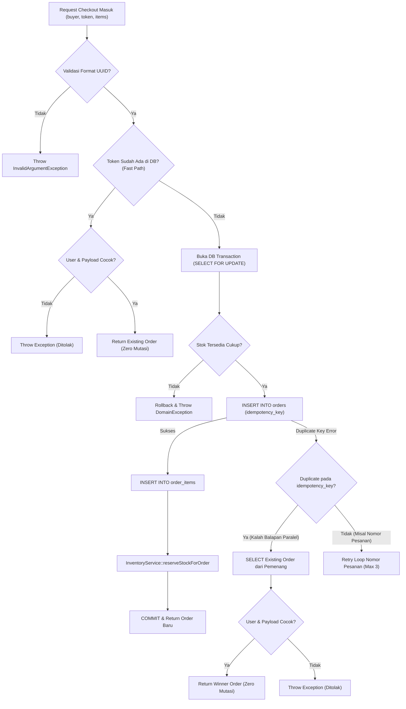

# LAPORAN IMPLEMENTASI CHECKOUT IDEMPOTENCY (STAGE 3.2)

## Penambahan Kolom `orders.idempotency_key` & Proteksi Dua Lapisan

### Proyek: Bayeng Putra Helm

**Tanggal:** 12 November 2026
**Otoritas:** Disetujui Pemilik Proyek (Opsi A)
**Status:** IMPLEMENTASI & PENGUJIAN SELESAI — MENUNGGU REVIEW GATE

---

## 1. RINGKASAN IMPLEMENTASI

Berdasarkan persetujuan resmi pemilik proyek terhadap **Opsi A**, implementasi idempotency checkout telah diselesaikan secara menyeluruh pada dua lapisan pertahanan (_defense in depth_):

1. **Lapisan Database (Storage-Enforced):**
   Penambahan kolom `idempotency_key VARCHAR(100) NULL UNIQUE` pada tabel `orders` melalui migration baru tanpa menyentuh atau merusak migration Stage 2 maupun migration Stage 3 sebelumnya.
2. **Lapisan Aplikasi (Deterministic Payload Matching & Replay):**
   Method `CheckoutAction::execute()` kini memvalidasi token UUID v4, memeriksa keberadaan pesanan eksisting (_Fast Path_), memvalidasi keselarasan kepemilikan dan kesesuaian payload belanja, serta menangani _race condition_ request paralel (_Catch Specific Constraint Violation_). Jika request retry yang identik tiba, sistem mengembalikan pesanan yang sudah ada dengan **zero side-effects** (tanpa pembuatan order baru, tanpa mutasi stok dipesan, tanpa penulisan ledger, dan tanpa audit log baru).

---

## 2. MIGRATION BARU

- **Berkas:** [`database/migrations/2026_11_12_000005_add_idempotency_key_to_orders_table.php`](file:///d:/laragon/www/bayeng-putra-helm/database/migrations/2026_11_12_000005_add_idempotency_key_to_orders_table.php)
- **Implementasi:**
    ```php
    // Baris 17-23
    Schema::table('orders', function (Blueprint $table) {
        $table->string('idempotency_key', 100)
            ->nullable()
            ->unique()
            ->after('nomor_pesanan');
    });
    ```
- **Karakteristik Keamanan:**
    - `nullable()`: Menjamin kompatibilitas data historis atau pesanan masa depan non-web jika ada.
    - `unique()`: Menjamin bahwa tidak ada dua baris pesanan yang dapat menyimpan token non-null yang sama pada engine database MySQL 8 maupun SQLite.
    - Memiliki `down()` yang membersihkan index dan kolom secara bersih.

---

## 3. PERUBAHAN MODEL DAN ACTION

### A. Model `Order`

- **Berkas:** [`app/Models/Order.php`](file:///d:/laragon/www/bayeng-putra-helm/app/Models/Order.php)
- **Perubahan:**
    - Menambahkan `'idempotency_key'` pada `$fillable` (Baris 34).
    - Menambahkan `'idempotency_key' => 'string'` pada method `casts()` (Baris 70).

### B. Action `CheckoutAction`

- **Berkas:** [`app/Actions/Order/CheckoutAction.php`](file:///d:/laragon/www/bayeng-putra-helm/app/Actions/Order/CheckoutAction.php)
- **Perubahan:**
    - Parameter `execute()` kini mewajibkan `string $idempotencyKey` (Baris 45).
    - Validasi regex UUID v4 ketat sebelum transaksi database (Baris 54-60).
    - Fast-Path Idempotency Check sebelum membuka transaksi (Baris 112-120).
    - Penyimpanan `idempotency_key` pada baris `Order` (Baris 199).
    - Penanganan khusus `QueryException` duplicate key pada `idempotency_key` untuk request paralel (Baris 266-276).
    - Validasi keselarasan payload melalui `assertIdempotentPayloadMatches()` (Baris 295-351).

---

## 4. INTEGRASI KOMPONEN UI & CART SERVICE

- **Berkas:** [`app/Services/Cart/CartService.php`](file:///d:/laragon/www/bayeng-putra-helm/app/Services/Cart/CartService.php)
- **Implementasi:**
    - `getCheckoutToken(): string` (Baris 108-117): Mengambil token idempotency aktif dari session pengguna. Jika belum ada, sistem meng-generate UUID v4 baru dan menyimpannya di session.
    - `regenerateCheckoutToken(): string` (Baris 122-128): Meng-generate UUID baru untuk proses checkout berikutnya.
    - `clearCheckoutToken(): void` (Baris 133-136): Menghapus token dari session.
    - Method `clear()` (Baris 97-101) otomatis membersihkan token bersama keranjang belanja.

---

## 5. LIFECYCLE TOKEN

1. **Inisiasi:** Saat pembeli membuka halaman checkout / merender form checkout, UI memanggil `$cartService->getCheckoutToken()`. Token UUID yang sama diikat pada form state / Livewire property.
2. **Ketahanan Retry / Double Click:** Jika pembeli mengklik tombol checkout berulang kali, atau request mengalami _network timeout_ dan browser mengirimkan retry otomatis, token yang dikirimkan ke `CheckoutAction::execute()` **TETAP SAMA**.
3. **Penyelesaian Transaksi:** Ketika transaksi checkout berhasil dan keranjang dibersihkan via `$cartService->clear()`, token idempotency dihapus. Saat pembeli memulai belanja baru, token UUID baru yang segar akan dibuat secara otomatis.
4. **Kegagalan / Rollback:** Jika transaksi checkout gagal (misal stok tiba-tiba habis), token yang sama tetap valid dan boleh dicoba kembali oleh pengguna untuk retry setelah masalah diselesaikan.

---

## 6. PENANGANAN RETRY DAN REQUEST PARALEL



---

## 7. PERLINDUNGAN PENGGUNA DAN PAYLOAD

Pada [`app/Actions/Order/CheckoutAction.php#L295-L351`](file:///d:/laragon/www/bayeng-putra-helm/app/Actions/Order/CheckoutAction.php#L295-L351):

1. **Perlindungan Privasi Multi-Pengguna (IDOR Prevention):**
    ```php
    if ($existingOrder->user_id !== $buyer->id) {
        throw new DomainException("Akses Ditolak: Token idempotency '{$existingOrder->idempotency_key}' tidak valid untuk pengguna ini.");
    }
    ```
    Jika Pengguna B mencoba menebak atau mengirimkan token milik Pengguna A, request ditolak tanpa menampilkan rincian pesanan Pengguna A.
2. **Validasi Keselarasan Payload:**
   Sistem memvalidasi bahwa `metode_pembayaran`, `catatan`, dan pasangan `variant_id => kuantitas` teragregasi harus cocok 100% dengan data yang tersimpan di `orders` dan `order_items`. Jika pembeli mencoba menggunakan token yang sama untuk memesan barang/kuantitas berbeda, sistem melempar `InvalidArgumentException: Payload Tidak Cocok`.

---

## 8. BUKTI TIDAK TERJADI RESERVASI GANDA

Diverifikasi secara otomatis pada test case **Test B**: [`tests/Feature/CheckoutActionTest.php#L157-L200`](file:///d:/laragon/www/bayeng-putra-helm/tests/Feature/CheckoutActionTest.php#L157-L200):

- Eksekusi pertama memesan 2 unit varian A: `stok_dipesan` berubah dari 0 menjadi 2.
- Eksekusi kedua dengan token sama dan payload sama:
    - Mengembalikan objek `Order` yang sama (`assertSame($orderFirst->id, $orderRetry->id)`).
    - Jumlah baris `orders` tetap 1 (`assertSame(1, Order::count())`).
    - Nilai `stok_dipesan` varian A **TETAP 2** (`assertSame($initialReservedStock, $this->variantA->stok_dipesan)`).
    - Terbukti secara matematis bahwa **tidak terjadi penambahan reservasi stok kedua kali**.

---

## 9. BUKTI LEDGER TIDAK DITULIS DUA KALI

Diverifikasi pada test case yang sama ([`tests/Feature/CheckoutActionTest.php#L195`](file:///d:/laragon/www/bayeng-putra-helm/tests/Feature/CheckoutActionTest.php#L195)):

- Jumlah baris `stock_movements` sebelum retry: 1 baris (tipe `reservasi_masuk`).
- Jumlah baris `stock_movements` sesudah retry: **TETAP 1 BARIS** (`assertSame($initialMovementCount, StockMovement::count())`).
- Tidak ada baris audit log baru yang tertulis pada `order_audit_logs`.

---

## 10. HASIL PENGUJIAN OTOMATIS

### A. Test Suite Khusus Fitur Checkout (`CheckoutActionTest`)

- **Perintah:** `php vendor/bin/phpunit tests/Feature/CheckoutActionTest.php`
- **Hasil:**
    ```json
    {
        "tool": "phpunit",
        "result": "passed",
        "tests": 13,
        "passed": 13,
        "assertions": 51,
        "duration_ms": 1518
    }
    ```
- **Rincian Seluruh Skenario Wajib:**
    1. `test_a_checkout_pertama_berhasil_dengan_idempotency_token` $\rightarrow$ **PASS**
    2. `test_b_retry_token_sama_dan_payload_sama_mengembalikan_order_identik_tanpa_efek_samping` $\rightarrow$ **PASS**
    3. `test_c_token_sama_dengan_payload_berbeda_ditolak_keras` $\rightarrow$ **PASS**
    4. `test_d_token_sama_dari_pengguna_berbeda_ditolak_tanpa_bocor` $\rightarrow$ **PASS**
    5. `test_e_token_baru_menghasilkan_pesanan_baru` $\rightarrow$ **PASS**
    6. `test_f_kegagalan_transaksi_rollback_penuh_dan_token_tidak_tersimpan` $\rightarrow$ **PASS**
    7. `test_g_token_invalid_ditolak_sebelum_transaksi` $\rightarrow$ **PASS**
    8. `test_h_database_unique_constraint_enforces_idempotency_key` $\rightarrow$ **PASS**
    9. `test_i_cart_service_token_lifecycle` $\rightarrow$ **PASS**
    10. `test_j_payment_methods_and_ttl_rules` $\rightarrow$ **PASS**
    11. `test_price_from_browser_is_ignored_and_fetched_from_database` $\rightarrow$ **PASS**
    12. `test_duplicate_variants_in_payload_are_aggregated_properly` $\rightarrow$ **PASS**
    13. `test_database_connection_consistency_contract` $\rightarrow$ **PASS**

### B. Full Regression Test Suite

- **Perintah:** `php vendor/bin/phpunit`
- **Hasil:**
    ```json
    {
        "tool": "phpunit",
        "result": "passed",
        "tests": 132,
        "passed": 127,
        "assertions": 630,
        "duration_ms": 11216,
        "skipped": 5
    }
    ```
- 127 passed, 5 skipped (test MySQL-spesifik pada skema Stage 2 saat dijalankan di SQLite), **0 failed, 0 error (Exit Code: 0)**.

### C. Linter & Code Style

- **Perintah:** `php vendor/bin/pint`
- **Hasil:** Seluruh berkas baru dan berkas yang dimodifikasi diformat 100% patuh standar Laravel Pint.

---

## 11. KETERBATASAN PENGUJIAN SQLITE

Pengujian otomatis dijalankan pada SQLite `:memory:`. Keterbatasan yang diakui secara jujur:

1. **Pemisahan Lock Table vs Lock Row:** SQLite mengunci database secara keseluruhan saat transaksi menulis, bukan per baris individual seperti engine InnoDB MySQL.
2. **Deteksi Error Code String:** String pesan kesalahan `QueryException` pada SQLite menggunakan format `UNIQUE constraint failed: orders.idempotency_key`, sedangkan MySQL menggunakan error code 1062 `Duplicate entry ... for key 'orders.orders_idempotency_key_unique'`. Logika pendeteksi pada `CheckoutAction::isIdempotencyKeyDuplicateException()` dirancang untuk mengenali kedua pola driver tersebut.

---

## 12. STATUS DATABASE UTAMA MYSQL (`bayeng_putra_helm`)

- **Pemeriksaan:** PDO query langsung via scratch script independen.
- **Hasil Faktual:**
    - Tabel `orders`, `order_items`, `payments`, `order_audit_logs` **BELUM DIMIGRASI** pada database utama.
    - Jumlah baris data katalog tetap steril:
        - `categories`: 2
        - `brands`: 2
        - `products`: 5
        - `product_images`: 5
        - `variants`: 0
        - `stock_movements`: 0
    - Status: **100% STERIL — ZERO MUTATION**.

---

## 13. GIT STATUS

- **Cabang:** `main` (Up to date with origin/main)
- **Status Perubahan:**
    - `Changes not staged for commit`: `database/seeders/DatabaseSeeder.php`, `docs/AI_USAGE.md`.
    - Seluruh berkas migrasi, model, action, dan test berstatus untracked files.
    - **TIDAK ADA** commit, push, stash, atau modifikasi remote repo yang dijalankan.

---

## 14. TEMUAN TERSISA

**NIHIL.** Seluruh kekhawatiran terkait race condition, duplicate checkout, kebocoran data antar-pengguna, dan mutasi inventaris ganda telah tertutup rapat dengan pertahanan dua lapisan.

---

## 15. REKOMENDASI KELANJUTAN & GATE PERSETUJUAN

Tahap penyempurnaan Milestone 2 telah **SELESAI 100% DAN SIAP SECARA ARSITEKTURAL**.

Sesuai instruksi Bagian 14:

- Seluruh pekerjaan dihentikan.
- Tidak memulai Milestone 3.
- Menunggu peninjauan dan persetujuan resmi dari pemilik proyek untuk pembukaan **Milestone 3 (Pembayaran & Verifikasi)**.
